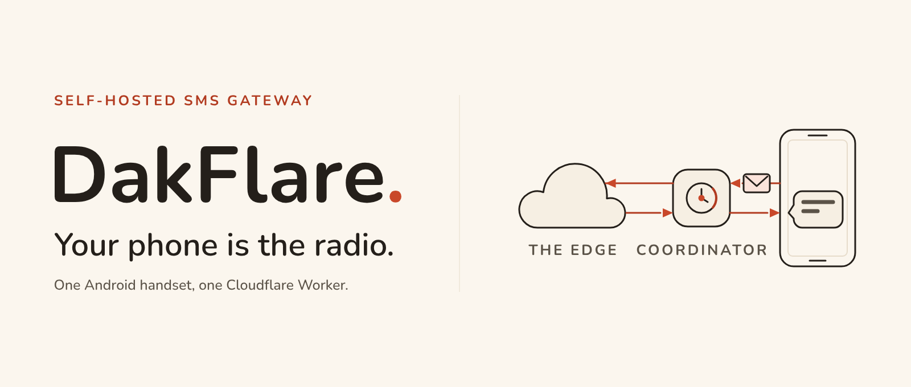
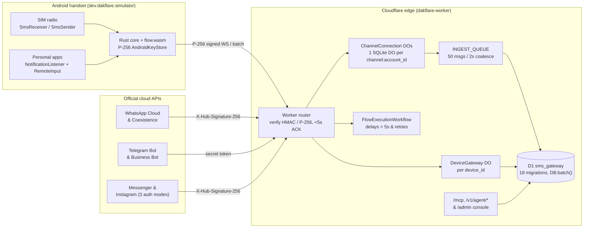

<div align="center">

<a href="https://github.com/JonyBepary/dakflare">
  
</a>

<br />
<br />

# DakFlare

**A sovereign multi-platform messaging hub and SMS gateway on Cloudflare Workers and Android.**

*The handset is the radio. The Worker is the coordinator. The console is where an operator watches both.*

<br />

[](https://github.com/JonyBepary/dakflare/actions/workflows/pipeline.yml)
[](./LICENSE)
[](https://nodejs.org/)

<br />

[**Quick Start**](#quick-start) · [**Architecture**](#architecture) · [**Channels**](#channels) ·
[**Wasm Flows**](#wasm-flows) · [**Agent & MCP**](#agent-control-plane--mcp) ·
[**Benchmarks**](#verified-benchmarks--gates) · [Docs & llms.txt](./apps/docs)

</div>

## Why DakFlare

**DakFlare** combines *Dāk* (ডাক, the relay-runner dispatch network that carried urgent letters across Bengal station by station) with the **Cloudflare** edge where the coordinator lives. It replaces per-message telecom SaaS and fragile VPS bridges with your own Android SIM and your own Cloudflare account: no third-party telecom SaaS, no per-message markup, and no shared secret between the phone and the edge.

<table>
  <tr>
    <td width="50%" valign="top">
      <h3>Zero Telecom SaaS, Zero Shared Secrets</h3>
      <p>The handset holds the SIM and wraps its ECDSA P-256 identity in hardware <code>AndroidKeyStore</code> (<code>keystore:v1:</code>); every request is signed with a five-line canonical string and a Durable Object nonce guard.</p>
    </td>
    <td width="50%" valign="top">
      <h3>Five Mediums, Per-Account Isolation</h3>
      <p>SMS, WhatsApp Cloud/Coexistence, Telegram, Messenger and Instagram each run in an isolated per-account SQLite Durable Object (<code>channel:account_id</code>).</p>
    </td>
  </tr>
  <tr>
    <td width="50%" valign="top">
      <h3>One Rust/Wasm Flow Engine Everywhere</h3>
      <p>Author a deterministic <code>dakflare.flow/v2</code> graph once; the same crate runs offline on Android and compiles to <code>flow.wasm</code> for the Worker.</p>
    </td>
    <td width="50%" valign="top">
      <h3>Agent-Operable, Never Unbounded</h3>
      <p>Scoped <code>dkf_agt_</code> tokens, 9 MCP tools, 4 WebMCP editor tools, and time-boxed human grants. Costly writes need approval; <code>devices:revoke</code> is never grantable.</p>
    </td>
  </tr>
</table>

## Architecture

Official cloud APIs run on Workers with **one `ChannelConnection` SQLite Durable Object per `(channel, account_id)`**, so accounts sharing a platform never contend on one object. Personal sessions stay off Workers and run on the handset over the P-256 signed transport.



> [!NOTE]
> **Five SQLite Durable Objects**: `DeviceGateway` (per-handset command queue, replay nonces, alarms), `ChannelConnection` (per-account dedupe, 24h window, rate buckets), `AuthGuard` (per-account and per-IP lockouts), `AuthorityGuard` (grant expiry windows), `AssistantAgent` (pinned operator runtime).

Device auth is not a shared secret: each phone signs `METHOD\nPATH\nTIMESTAMP\nNONCE\nSHA256(body)` with a P-256 key whose at-rest form is `keystore:v1:<iv>:<ciphertext>`, wrapped by a non-exportable AndroidKeyStore AES-GCM key. A copied database alone cannot impersonate the phone.

## Quick Start

Requires **Node.js 22+** and an authenticated Cloudflare [`cf`](https://developers.cloudflare.com/) CLI.

```bash
git clone https://github.com/JonyBepary/dakflare && cd dakflare
npm install -g .                      # installs the zero-dependency `dakflare` CLI

dakflare init --local                 # generate local secrets into worker/.dev.vars, never committed
cf auth login
dakflare up --email you@example.com    # provision D1/KV, apply 0001–0018, deploy, bootstrap owner, pair a phone
dakflare doctor                        # config, health, schema, migrations, bindings, phone
```

Open the printed owner invite on the Worker's own HTTPS hostname, redeem it and create a passkey; that account is the owner. Then pair the handset (`dakflare pair --qr`) and send:

```bash
dakflare send --device <device_id> --to +8801540196080 \
  --body "DakFlare edge gateway online" --idempotency-key quickstart-001 --agent
```

> [!IMPORTANT]
> **SMS is asynchronous and `SENT` is not delivery.** `send` waits 10 seconds and exits from the outcome; exit code `75` means it is still in flight, so poll `dakflare status <command_id> --wait 60s` and **never** re-run `send`. `verification.passed` is `true` only on `DELIVERED`.

`cf` is the deploy path and it sets secrets too (`cf workers secrets update`); `wrangler` remains for local dev, `tail` and `d1 export`, because `cf` cannot stream logs yet. `npm run deploy` builds the console first and refuses a dirty tree, migrations are applied by hand, and CI never deploys. `docs/OPS_DEPLOY.md` has the manual provisioning steps, the secrets, the order of operations and the rollback.

## Channels

| Medium | Execution tier | Auth and verification | Delivery and window model |
| --- | --- | --- | --- |
| **SMS** | Android (`DeviceGateway`) | P-256 ECDSA, `AndroidKeyStore` | WebSocket primary with polling fallback; `SENT` → `DELIVERED` |
| **WhatsApp Cloud & Coexistence** | Worker, `ChannelConnection` | Graph API, `X-Hub-Signature-256` | 24h free-form window plus templates; receipts folded to `delivered` |
| **Telegram Bot & Business** | Worker, `ChannelConnection` | `X-Telegram-Bot-Api-Secret-Token` | Stateless HTTPS webhook; `429 retry_after` backoff |
| **Facebook Messenger** | Worker, `ChannelConnection` | Graph API, `X-Hub-Signature-256` (PSID) | `<5s` webhook ACK; 24h window plus `HUMAN_AGENT` tag |
| **Instagram Messaging** | Worker, `ChannelConnection` | `unified_login` · `instagram_login` · `facebook_login` | All three Meta login setups per connector; 24h window, comment replies |
| **Personal WA / TG / Messenger / IG** | Android (`MessagingNotificationBridge`) | `NotificationListenerService` + `RemoteInput` | No third-party protocol libraries, no ban risk; P-256 signed upload to `/v1/edge/incoming/batch` |

Connector secrets are sealed at rest with AES-256-GCM (`WEBHOOK_SECRET_KEY`), cached in KV for 60s on the hot path, and never returned after creation; admin CRUD routes enforce `assertHuman` and refuse member or agent sessions. Every medium is stored as a conversation, so the console and the flow engine see one message model.

## Wasm Flows

A flow is a canonical, acyclic **`dakflare.flow/v2`** document with 9 node kinds (`trigger`, `extract`, `set_var`, `condition`, `switch`, `delay`, `webhook`, `send_sms`, `stop`). No coordinates are needed: the Worker computes a deterministic `rank-v1` layout on save and refuses cycles or variables unbound on any branch.

```bash
dakflare flows apply order-reply.json --dry-run --agent          # structural diff, no write
dakflare flow test --flow wf_orders --corpus corpus.jsonl        # run against flow.wasm
dakflare extract synthesize --samples samples.json --group order # prove a regex on positives and negatives
dakflare flows heal wf_orders --samples samples.json             # zero-regression check on D1 history
```

Drift alerts (`extraction_drift`) fire when a stored pattern stops matching traffic. The editor has `Steps`, `Map` and a read-only `Source` sheet; a proposed patch arrives as a dashed ghost with one banner to accept or revert, and acceptance is a single undo step.

## The console

Svelte 5 on SvelteKit 3, prerendered to static assets and served by the Worker at `/admin`: hand-written CSS over a token system (`design/tokens.css`: primitive, semantic, component), warm cream surfaces, pastel containers that never carry body text, one coral action per screen, mono for anything compared against a log. Pages cover deployment health, the fleet and message log, the rules-vs-flows pipeline, approvals and live grants, the audit log, sign-in factors and invites.

It measures its **content column, not the window**: a 249 px rail leaves a 914 px window about 616 px, so tables switch to stacked rows on a container query over their card rather than `@media`, and every page was measured at 390, 768, 914, 1024 and 1440 with no horizontal overflow.

One floating **Assistant** panel sits over every page: it keeps the transcript, takes up to three attachments, carries an idempotency key per turn so a retry replays the recorded answer, and can only *propose* a write — every act needs a grant and lands in the journal and the audit log. Sign-in is passkey-first, with optional TOTP, password and magic link; sessions are host-only, and `AUTH_MODE` chooses between the legacy admin token and Better Auth accounts.

`docs/CONSOLE.md` is the surface reference, `docs/CONSOLE_UX.md` the layout and interaction rules, and `docs/AGENT_RUNTIME.md` the assistant contract.

## The phone

A real SMS app, not a config page: four frames behind a dock (**Threads · Device · Flows · Settings**), a conversation view with paging, a composer that counts GSM-7/UCS-2 segments, and inline reply from the notification. It holds the **default SMS app role**, so it receives `SMS_DELIVER`, writes what it stores into `content://sms`, and posts one silent notification per thread.

A `remoteMessaging` foreground service **drains pending rows every 5 minutes**, while the **flow fetch interval is 15 minutes**; both return after a reboot. The device identity is a P-256 key stored as `keystore:v1:<iv>:<ciphertext>`, wrapped by a non-exportable AndroidKeyStore AES-GCM key, so a copied database cannot impersonate the phone.

Build and check a signed APK:

```bash
cd simulator && source ~/.config/dakflare/android-env.sh   # SDK 37, NDK 27, JDK 21, Rust targets
npx tauri android build --debug --apk --target aarch64
adb install -r -g app/build/outputs/apk/universal/debug/app-universal-debug.apk
../simulator/scripts/device-check.sh                       # 8 checks against the handset
```

Release signing lives outside the repo at `~/.config/dakflare/dakflare-release.jks`, driven by `simulator/scripts/release-apk.sh`; **losing that key means no future update can carry the same app id**. `docs/PHONE_APP.md` covers the app, `docs/PHONE_RELEASE.md` the signing key and its fingerprint.

## Agent Control Plane & MCP

An agent never holds the admin token. It holds a `dkf_agt_` token minted with a scope set, and every irreversible action also needs a live, time-boxed grant a human approves in the console or with `dakflare auth approve`.

- **Tokens and scopes**: reads (`messages:read`, `devices:read`, `flows:read`, `audit:read`), cheap writes (`sms:send`, `rules:write`, `flows:write`, `alerts:write`), and the costly four (`sms:send:production`, `flow_deploy_prod`, `dlq_bulk_replay`, `enable_shortcode`). `devices:revoke` and `auth:reset` are not scopes at all, so neither a token nor a grant can hold them. The token is printed once; D1 stores a digest.
- **Grants and approvals**: a ladder of 1m, 5m, 15m, 30m, 1h, 1d, 7d and 30d, capped per scope; production SMS is capped at one hour and must name recipients or a device. `GET /v1/admin/approvals`, the console's Approvals page, or `dakflare auth approvals|approve|reject`; a request that loses the race is told who answered first.
- **MCP**: `/mcp` serves 9 scope-filtered tools (`list_devices`, `read_messages`, `command_status`, `list_flows`, `get_flow`, `trace`, `triage`, `telemetry`, `send_sms`) over streamable HTTP, with RFC 9728/8414/8707 OAuth discovery; mutating tools require elicitation and a TOTP code before a grant is minted. `dakflare mcp serve` bridges the same tools over stdio, and `/v1/mcp` keeps earlier tokens working.
- **WebMCP**: `/admin/workflows/edit` registers 4 editor tools (`dakflare_get_flow_ast`, `dakflare_stage_flow_patch`, `dakflare_synthesize_pattern`, `dakflare_diagnose_message`) with the ghost-patch staging the console shows.
- **Agent analysis and webhooks**: `POST /v1/agent/triage|telemetry|diagnose|synthesize` give a model the reading an operator does by eye, behind the same gate as the console; `POST /v1/webhooks/:id` wakes it from outside, HMAC-signed, idempotent per delivery id, and able to propose but never act. `docs/AGENT_SURFACE.md` and `docs/AGENT_RUNTIME.md` are the references.
- **Worker-to-Worker**: bind `entrypoint = "DakFlareApi"` from another Worker or Workflow without bypassing scopes, limiters or audit.

## CLI

`dakflare` is zero-dependency, and under `--agent` it prints one compact JSON document per call, never prompts and never colours. **27 commands**: provision (`init`, `up`, `doctor`, `pair`, `devices`, `revoke`), messaging (`send`, `status`, `audit`), accounts and agents (`auth …`), automation (`flows apply|heal`, `rules apply|test`, `extract synthesize`), agent work (`ask`, `fix`, `flow test --corpus`, `flow apply --token`, `schema --flow-v2`), provenance (`trace`, `alerts`, `dlq`, `ws inspect`) and contract (`capabilities`, `describe`, `schema`, `examples`, `mcp serve`, `key fingerprint`).

Exit codes are semantic: `0` ok, `1` failed, `2` usage, `3` not found, `4` permission, `5` conflict, `6` precondition, `75` still in flight. Pass `--idempotency-key` whenever a retry is possible: the same key returns the same `command_id` instead of a second SMS. `docs/CLI.md` has every flag and the contract.

## Skills for agents

Five `SKILL.md` packages teach an agent the CLI contract, the async send rule and the authority model: `dakflare-provision`, `dakflare-messaging`, `dakflare-flows`, `dakflare-agents` and `dakflare-multichannel`, which covers the channel connectors and which of the two execution tiers a medium runs on. Install them with `npx skills add` or point an agent at `skills/`.

## Verified Benchmarks & Gates

CI (`.github/workflows/pipeline.yml`) runs hermetically with zero Cloudflare credentials; deploys and migrations run from the operator's terminal.

| Gate | Measured result (`27fb51c`) |
| --- | --- |
| **Worker unit and integration (Vitest)** | **54 passing** across 7 files; `typecheck` and `check:config` across 5 DO classes and 3 queue consumers |
| **Conformance harness** | **`SUITE PASSED` — 513 assertions** (P-256 vectors, WebAuthn, replay, WS, rules, auth, ack timeouts) |
| **Android and Rust cores** | **110** `simulator/core` + **58** `simulator/flow` Rust tests; Svelte `0/0`; Gradle Kotlin compiles |
| **Console** | `svelte-check` `0/0`; `check-system` 0 failing |
| **Burst, WhatsApp** | 780/780 acked, 600 D1 rows, 0 duplicates, **p95 305 ms** (SLA `< 5,000 ms`) |
| **Burst, Messenger** | 780/780 acked, 600 D1 rows, 0 duplicates, **p95 338 ms** after the paging patch (SLA `< 5,000 ms`) |

Both platforms sit in a **p95 305–338 ms** band.

## Verifying it

```bash
cd worker && npm run typecheck && npm run check:config && npx vitest run
cd dashboard && npm run check
cd simulator/core && cargo test && cd ../flow && cargo test
./test-support/dev.sh && node dakflare_test_harness.mjs pair && node dakflare_test_harness.mjs suite
node test-support/channel-load-bench.mjs
cd worker && npm run verify:deploy               # the deploy gate
```

`npm run verify:deploy` is the deploy gate because `cf deploy` can exit `1` on a deploy that worked: it reads evidence instead, checking the version, the live routes, the workflow binding and the migration ledger.

Harness modes: `selftest`, `verify-vectors`, `pair`, `suite`, `hardening`, `multidevice`, `agent-pool`, `auth`, `password`, `lockout-global`, `password-rotate`, `magic`, `proxy`, `ws`, `stub` and `reset`. `agent-pool` covers ticket one-use and expiry, window ownership and webhook replay; the suite covers pairing, admin, reply state, auth, replay, rules, console surface, websockets, ack timeouts and the password factor, including a software WebAuthn authenticator so passkey assertions are real cryptography. `test-support/` holds the dev stack and the shared vectors.

## Documentation & Agent Endpoints

DakFlare ships a dual-audience **Fumadocs** site in [apps/docs](./apps/docs) alongside repo-local specs in [docs](./docs/README.md):

- **Human docs and OpenAPI playground**: `/docs`, `/docs/guides/multi-channel`, `/docs/reference/api-playground`, with per-page Copy Markdown, Open in ChatGPT/Claude/Perplexity/Cursor, and Share.
- **Machine-readable**: `/llms.txt`, `/llms-full.txt`, `/{path}.md` (`Accept: text/markdown`, `x-markdown-tokens`), `/openapi.json` (OpenAPI 3.1.0), `/SKILL.md`, `/AGENTS.md` and `POST /mcp`.

`docs/AGENT_SURFACE.md` documents `/v1/agent/triage|telemetry|diagnose|synthesize` and `/mcp`; a model never authorises a change, a grant does.

## Repository map

| Path | What |
| --- | --- |
| `worker/` | the Worker, 5 SQLite Durable Objects, 18 D1 migrations (`0001`–`0018`), channels, `flow.wasm`, MCP server |
| `dashboard/` | the Svelte 5 on SvelteKit 3 console, built into `worker/public/admin` and served at `/admin` |
| `cli/` | `dakflare`, zero-dependency Node 22+ (27 commands) and `cli/schema/flow-v2.json` |
| `simulator/` | Tauri v2 Android app (Rust `core/`, `flow/`, `flow-wasm/`, Kotlin `bridge/`, Svelte 5 UI) |
| `design/` | design tokens and the token preview |
| `docs/` | every document, indexed by `docs/README.md`: spec, agent surface and runtime, runbooks, console notes, `STATE_MACHINES.md`, `history/` |
| `apps/docs/` | the Fumadocs site, served as HTML and as markdown per page |
| `skills/` | five `SKILL.md` packages: provision, messaging, flows, agents, multichannel |
| `contracts/` | `mcp-tools.json`, generated by `worker/scripts/mcp-contract.mjs` (currently stale at 7 of the 9 tools) |
| `test-support/` | local dev stack, protocol and flow vectors, burst benchmark, platform and skills gates |

## Known gaps

- **MMS** is not supported; a push produces a notification saying so rather than vanishing.
- **WhatsApp Coexistence** ingests `field: messages` only (`smb_message_echoes` and `history` are skipped by name).
- **Personal-channel replies** have `MessagingNotificationBridge.sendReply(...)` ready, pending the Tauri command wiring from the Rust core.
- **Magic link** needs a sender: without `RESEND_API_KEY` the door is not advertised, because a door that cannot deliver a link would strand the login page.
- **TOTP enrolment needs a passkey**; a password-only account cannot turn it on. **`server-kdf`** is paid-tier only, by measurement.
- **`MEDIA_BUCKET` holds agent attachments only.** There is no route that serves message media, so an inbound photo is recorded by name and not fetched.
- **The assistant reads text, not pictures.** A file is attached and stored, text is folded into the turn, and an image is *named* with the prompt saying the model cannot see it — a caption the model invents is worse than an honest refusal. The transcript read stops at 40 messages, and a stateless deployment answers one question at a time. See `docs/ASSISTANT.md`.
- **Agent telemetry in the console** is one question at a time: no transcript, no polling, no export, and a 403 renders as a permission state.
- **A proxy in front of the console breaks the cookie**, not the sign-in: the session cookie is host-only, so open the deployment's own HTTPS URL. `/admin/login` says the session could not be started rather than asking for a code.
- **An older Worker without `/v1/auth/challenge`** makes the console drop the code step and show the doors. That is the safe direction: a challenge is never inferred.

## License

**AGPL-3.0-only**; see [LICENSE](./LICENSE). Because §13 requires a network deployment to offer its source to the people using it, the Worker serves that offer publicly at `/source`, a 302 to `SOURCE_URL` so the address is configuration rather than a hardcoded link that goes stale on a fork.
