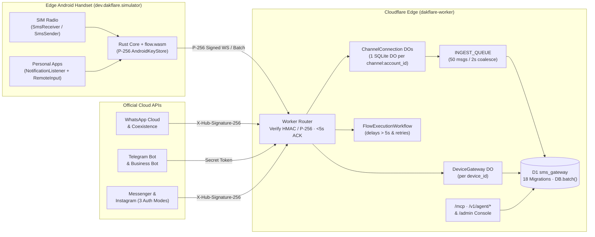

<div align="center">

<a href="https://github.com/JonyBepary/dakflare">
  
</a>

<br />
<br />

# DakFlare

**A sovereign multi-platform messaging hub and SMS gateway on Cloudflare Workers and Android.**

*The handset is the radio. The Worker is the coordinator. The console is where an operator watches both.*

<br />

[](https://github.com/JonyBepary/dakflare/actions/workflows/pipeline.yml)
[](./LICENSE)
[](https://nodejs.org/)

<br />

[**Quick Start**](#quick-start) · [**Architecture**](#architecture) · [**Channels**](#channels) · [**Wasm Flows**](#wasm-flows) · [**Agent & MCP**](#agent-control-plane--mcp) · [**Benchmarks**](#verified-benchmarks--gates) · [Docs & llms.txt](./apps/docs)

</div>

## Why DakFlare

**DakFlare** combines *Dāk* (ডাক, the relay-runner dispatch network that carried urgent letters across Bengal station by station) with the **Cloudflare** edge where the coordinator lives. It replaces per-message telecom SaaS and fragile VPS bridges with your own Android SIM and your own Cloudflare account: no third-party telecom SaaS, no per-message markup, and no shared secret between the phone and the edge.

<table>
  <tr>
    <td width="50%" valign="top">
      <h3>Zero Telecom SaaS, Zero Shared Secrets</h3>
      <p>The handset holds the SIM and wraps its ECDSA P-256 identity in hardware <code>AndroidKeyStore</code> (<code>keystore:v1:</code>). Every request is signed with a five-line canonical string and checked by a Durable Object nonce replay guard.</p>
    </td>
    <td width="50%" valign="top">
      <h3>Five Mediums, Per-Account Isolation</h3>
      <p>SMS, WhatsApp Cloud/Coexistence, Telegram, Messenger, and Instagram each run in an isolated per-account SQLite Durable Object (<code>channel:account_id</code>).</p>
    </td>
  </tr>
  <tr>
    <td width="50%" valign="top">
      <h3>One Rust/Wasm Flow Engine Everywhere</h3>
      <p>Author a deterministic <code>dakflare.flow/v2</code> graph once. The same Rust crate (<code>simulator/flow</code>) runs offline on Android and compiles to <code>flow.wasm</code> for the Worker fallback and browser simulator.</p>
    </td>
    <td width="50%" valign="top">
      <h3>Agent-Operable, Never Unbounded</h3>
      <p>Scoped <code>dkf_agt_</code> tokens, 9 Streamable HTTP MCP tools, 4 WebMCP editor tools, and time-boxed human grants (with TOTP elicitation). Costly writes require approval; <code>devices:revoke</code> is never grantable.</p>
    </td>
  </tr>
</table>

## Architecture

[](docs/assets/dakflare-architecture.jpg)

*Click the figure for its full 1600 px size; the labels are small at README width, so the same
diagram is reproduced as text below.*

Three tiers, one trust boundary. The **handset** owns the SIM and the personal-app bridge, and signs
every request with a P-256 key held in `AndroidKeyStore`. The **Worker** verifies that signature — or
Meta's `X-Hub-Signature-256`, or Telegram's secret token — and answers inside Meta's five-second
window. Storage and coordination live in **six SQLite Durable Objects**, one per unit that needs
serialisation: `DeviceGateway` per handset, `ChannelConnection` per `(channel, account_id)`,
`AuthGuard` and `AuthorityGuard` as singletons, and `AssistantAgent` pinned to one name.

Official cloud APIs run directly on Workers; personal sessions stay off them, on the phone. That is
why five accounts on one platform are five isolated objects rather than one hot one.

<details>
<summary><strong>The same diagram as text</strong> (Mermaid source, for diffs)</summary>



</details>

## Quick Start

Requires **Node.js 22+** and an authenticated Cloudflare [`cf`](https://developers.cloudflare.com/) CLI (`cf auth login`).

Install the repository and the `dakflare` command in one line. It checks Node, fetches the
checkout to `./dakflare`, links `dakflare` into `~/.local/bin` (printing the `export PATH` line if
that directory is not on your `PATH`), and runs it once to prove the binary:

```bash
curl -fsSL https://raw.githubusercontent.com/JonyBepary/dakflare/main/install.sh | sh
```

Then provision from the checkout:

```bash
cd dakflare
cd worker && npm install && cd ..

# 1. Generate local secrets into worker/.dev.vars (never committed)
dakflare init --local

# 2. Provision D1/KV, apply migrations 0001 to 0019, deploy Worker + console, bootstrap owner & pairing code
cf auth login
dakflare up --email you@example.com

# 3. Point the CLI at your Worker and verify end-to-end health
dakflare init --url https://<your-worker>.workers.dev --token-file worker/.dev.vars
dakflare doctor
```

Open the printed owner invite URL on the Worker's own HTTPS hostname, enroll a **Passkey**, pair your Android handset (`dakflare pair --qr`), and send your first verified SMS:

```bash
dakflare send \
  --device <device_id> \
  --to +8801540196080 \
  --body "DakFlare edge gateway online" \
  --idempotency-key "quickstart-001" \
  --agent
```

> [!IMPORTANT]
> **SMS is asynchronous and `SENT` is not delivery.** `dakflare send` waits 10 seconds by default. Exit code `75` means the command is still in flight: poll `dakflare status <command_id> --wait 60s`, and **never** re-run `send`. `verification.passed` is `true` only on `DELIVERED`.

<details>
<summary><strong>Manual provisioning (step by step without <code>dakflare up</code>)</strong></summary>

```bash
cd worker
cp wrangler.template.toml wrangler.toml
cp cloudflare.config.template.ts cloudflare.config.ts
npx wrangler d1 create sms_gateway              # copy UUID into BOTH cloudflare.config.ts & wrangler.toml
npx wrangler kv namespace create KV             # copy ID into BOTH files
npx cf d1 migrations apply <D1_DATABASE_ID>     # cf requires the UUID, never the database name
npx cf workers secrets update ADMIN_TOKEN --worker dakflare-worker --type secret_text
npx cf workers secrets update BETTER_AUTH_SECRET --worker dakflare-worker --type secret_text
npx cf workers secrets update AUTH_PEPPER --worker dakflare-worker --type secret_text
npm run deploy                                  # builds console into worker/public/admin + cf deploy
npm run verify:deploy                           # verify live routes, version, workflow & migration ledger
```

</details>

## Channels

| Medium | Execution Tier | Auth & Verification | Delivery & Window Model |
| :--- | :--- | :--- | :--- |
| **SMS** | Edge Android (`DeviceGateway`) | P-256 ECDSA + `AndroidKeyStore` | WebSocket primary + polling fallback; `SENT` → `DELIVERED` |
| **WhatsApp Cloud & Coexistence** | Worker + `ChannelConnection` DO | Graph API + `X-Hub-Signature-256` | 24h free-form window + templates; status receipts folded to `delivered` |
| **Telegram Bot & Business Bot** | Worker + `ChannelConnection` DO | `X-Telegram-Bot-Api-Secret-Token` | Stateless HTTPS webhook + `429 retry_after` backoff |
| **Facebook Messenger** | Worker + `ChannelConnection` DO | Graph API + `X-Hub-Signature-256` (PSID) | `<5s` webhook ACK; 24h standard window + `HUMAN_AGENT` tag |
| **Instagram Messaging** | Worker + `ChannelConnection` DO | `unified_login` · `instagram_login` · `facebook_login` (IGSID) | All 3 Meta login setups per connector; 24h window + comment replies |
| **Personal WA / TG / Messenger / IG** | Edge Android (`MessagingNotificationBridge.kt`) | Native `NotificationListenerService` + `RemoteInput` | Zero third-party protocol libs, zero ban risk, P-256 signed upload (`POST /v1/edge/incoming/batch`) |

> [!TIP]
> Connector secrets are sealed at rest with AES-256-GCM (`WEBHOOK_SECRET_KEY`), cached in KV for 60s on the hot webhook path, and never returned after creation. Admin CRUD routes enforce `assertHuman` and refuse member or agent sessions.

**Templates and paced scheduling.** A body renders `{{name | fallback}}` and reports its GSM-7
or UCS-2 segment count before it leaves; a CSV audience import fills the variables. A send can be
queued for a time: the `Scheduler` paces it per SIM or per account (8-15 s of jitter for the radio,
a token bucket for cloud APIs), moves it past quiet hours instead of dropping it, and refuses a
cancel after the claim instead of pretending. `docs/SCHEDULING.md` has the claim rules.

## Wasm Flows

A flow is a canonical, acyclic **`dakflare.flow/v2`** document with 9 node kinds (`trigger`, `extract`, `set_var`, `condition`, `switch`, `delay`, `webhook`, `send_sms`, `stop`). No pixel coordinates are needed: the Worker computes deterministic `rank-v1` layouts on save and refuses cycles or variables unbound on any branch.

```bash
dakflare flows apply order-reply.json --dry-run --agent          # structural diff without writing
dakflare flow test --flow wf_orders --corpus corpus.jsonl        # local execution against flow.wasm
dakflare extract synthesize --samples samples.json --group order # prove regex against positives & negatives
dakflare flows heal wf_orders --samples samples.json             # zero-regression check against D1 history
```

## Agent Control Plane & MCP

- **Scoped Agent Tokens (`dkf_agt_`):** Minted with explicit scopes (`dakflare auth mint-agent-token`) and an independent hourly SMS budget (default `20/hr`). Costly scopes (`sms:send:production` ≤ 1h, `flow_deploy_prod` ≤ 1d, `enable_shortcode` ≤ 15m, `dlq_bulk_replay` ≤ 15m) require a live human grant. `devices:revoke` and `auth:reset` are `NEVER_GRANTABLE`.
- **Streamable HTTP MCP (`/mcp`) & Stdio Bridge (`dakflare mcp serve`):** Serves **9 scope-filtered tools** (`list_devices`, `read_messages`, `command_status`, `list_flows`, `get_flow`, `triage`, `telemetry`, `trace`, `send_sms`) with RFC 9728/8414/8707 OAuth discovery and TOTP elicitation for mutating calls.
- **Browser WebMCP (`/admin/workflows/edit`):** Registers 4 live editor tools (`dakflare_get_flow_ast`, `dakflare_stage_flow_patch`, `dakflare_synthesize_pattern`, `dakflare_diagnose_message`) with dashed ghost-patch staging.
- **Worker-to-Worker RPC (`DakFlareApi`):** Bind `entrypoint = "DakFlareApi"` from any Worker or Cloudflare Workflow in your account without bypassing scopes, limiters, or audit logs.
- **Five Installable Agent Skills (`skills/`):** `dakflare-provision`, `dakflare-messaging`, `dakflare-flows`, `dakflare-agents`, and `dakflare-multichannel` (`npx skills add`). `docs/CLI.md` has the 32-command inventory.

## Verified Benchmarks & Gates

CI (`.github/workflows/pipeline.yml`) runs hermetically with **zero Cloudflare credentials**; deploys and D1 migrations run locally from the operator's terminal.

| Gate | Measured Result (`ea34370`) |
| :--- | :--- |
| **Worker Unit & Integration (Vitest)** | **150 passing** across 13 files (`typecheck` + `check:config` across 6 DO classes & 3 queue consumers) |
| **Conformance Harness** | **`SUITE PASSED` (513 assertions)** covering P-256 vectors, WebAuthn, replay, WS, rules, auth, and ack timeouts |
| **Android Handset & Rust Cores** | **110** `simulator/core` + **58** `simulator/flow` Rust tests · Svelte `0/0` · Gradle Kotlin compiles |
| **Dashboard Console** | `svelte-check` `0/0` · `check-system` `0` failing across 76 files |
| **Multi-Account Burst Benchmark (WhatsApp)** | **780/780** acked · **600** D1 rows · **0** duplicates · **p95 307 ms** (SLA `< 5,000 ms`) |
| **Multi-Account Burst Benchmark (Messenger)** | **780/780** acked · **600** D1 rows · **0** duplicates · **p95 283 ms** (SLA `< 5,000 ms`) |

<details>
<summary><strong>Run the verification &amp; benchmark suite locally</strong></summary>

```bash
cd worker && npm run typecheck && npm run check:config && npx vitest run
cd dashboard && npm run check
cd simulator/core && cargo test && cd ../flow && cargo test
./test-support/dev.sh && node dakflare_test_harness.mjs pair && node dakflare_test_harness.mjs suite
node test-support/channel-load-bench.mjs
```

Harness modes: `selftest`, `verify-vectors`, `pair`, `suite`, `hardening`, `multidevice`, `agent-pool`, `auth`, `password`, `lockout-global`, `password-rotate`, `magic`, `proxy`, `ws`, `stub`, `reset`.

</details>

## Documentation & Agent Endpoints

DakFlare ships a dual-audience **Fumadocs** site in [apps/docs](./apps/docs) alongside repo-local specs in [docs](./docs/README.md):

- **Human Docs & OpenAPI Playground:** `/docs`, `/docs/guides/multi-channel`, `/docs/reference/api-playground` (with per-page **Copy Markdown**, **Open in ChatGPT/Claude/Perplexity/Cursor**, and **Share**).
- **Machine-Readable Endpoints:** `/llms.txt`, `/llms-full.txt`, `/{path}.md` (`Accept: text/markdown` + `x-markdown-tokens`), `/openapi.json` (OpenAPI 3.1.0), `/SKILL.md`, `/AGENTS.md`, and `POST /mcp`.

<details>
<summary><strong>Repository Map &amp; Known Gaps</strong></summary>

### Repository Map

| Path | Contents |
| :--- | :--- |
| `worker/` | Cloudflare Worker, 6 SQLite Durable Objects, 19 D1 migrations, channels, `flow.wasm`, MCP server |
| `dashboard/` | Svelte 5 on SvelteKit 3 operator console, built into `worker/public/admin` and served at `/admin` |
| `simulator/` | Tauri v2 Android handset app (Rust `core/`, `flow/`, `flow-wasm/`, Kotlin `bridge/`, Svelte 5 UI) |
| `cli/` | Zero-dependency Node 22+ `dakflare` CLI (32 commands) + `cli/schema/flow-v2.json` |
| `apps/docs/` | Dual-audience Fumadocs site (`/llms.txt`, `.md`, `/openapi.json`, `/SKILL.md`, `/mcp`) |
| `skills/` | Five `SKILL.md` packages for coding agents |
| `contracts/` | `mcp-tools.json`, generated from `tools/list` by `worker/scripts/mcp-contract.mjs` |
| `test-support/` | Local dev stack, shared protocol/flow vectors, burst benchmark (`channel-load-bench.mjs`), gates |
| `docs/` | Engineering specs (`MULTICHANNEL.md`, `STATE_MACHINES.md`, `OPS_DEPLOY.md`, `AGENT_RUNTIME.md`, `history/`) |

### Known Gaps

- **MMS** is not supported (surfaces an explicit notification rather than dropping silently).
- **WhatsApp Coexistence** ingests `field: messages` only (`smb_message_echoes` and `history` are skipped by name).
- **Personal-channel replies** are reachable from Tauri (`send_personal_reply`) but no handset or console screen calls the command yet; the connector send route serves `worker_do` connectors only.
- **Host-only session cookies:** always open `/admin` on the Worker's own HTTPS origin rather than through a localhost proxy.

</details>

## License

Licensed under **AGPL-3.0-only**. See [LICENSE](./LICENSE). Because §13 requires a network deployment to offer its source to the people using it, the Worker serves that offer publicly at `/source`, a 302 to `SOURCE_URL` so the address is configuration rather than a hardcoded link that goes stale on a fork.
