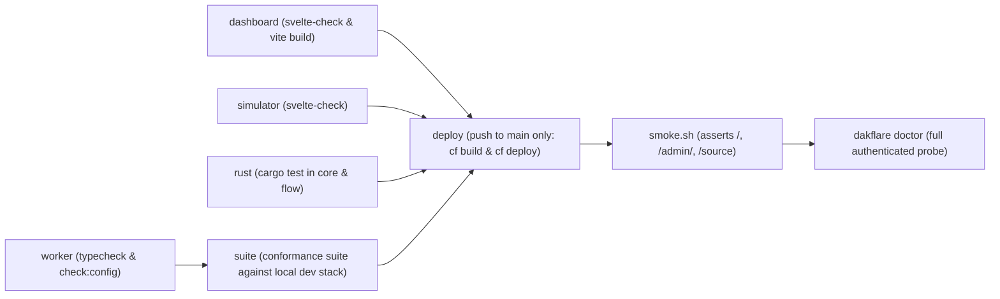

# DakFlare — Master System Specification & Repository Reference

> **Revision:** 5.2.1 (Post-PR #1 · Corrected against the code)  
> **Component Versions:**
> - Worker: `5.1.0` (`worker/package.json`)
> - CLI (`dakflare`): `0.2.0` (`cli/bin/dakflare.js`)
> - Root Package: `5.0.0` (`package.json`)
> - Web Console: Svelte 5.57, SvelteKit 3.0 (`dashboard/package.json`)
> - Mobile Simulator: Svelte 5.56, SvelteKit 2.65, Tauri v2 (`simulator/package.json`)
> - Wire Protocol: `PROTOCOL_CONTRACT_V5.md` (Frozen Rev D)
>
> **Authority Map:**
> - Wire Protocol Contract: `PROTOCOL_CONTRACT_V5.md`
> - Consolidated Database Schema: `worker/migrations/0001_baseline.sql`
> - Deployment & Operations: `docs/OPS_DEPLOY.md` and `docs/OPS_BACKUP.md`
> - Agent Skills: `skills/dakflare-provision/`, `skills/dakflare-messaging/`, `skills/dakflare-flows/`
> - Coding Agent Guidelines: `AGENTS.md`

---

## 1. System Architecture & Component Topology

DakFlare is a sovereign, zero-telecom-SaaS SMS gateway pairing a dedicated physical Android handset with a Cloudflare serverless edge (Workers, Durable Objects, D1, KV).

The central thesis: **The phone is the radio; the Worker is the coordinator.**

```
┌────────────────────────────────────────────────────────────────────────────────────────────────────────┐
│                                          OPERATOR TIER                                                 │
│                                                                                                        │
│   ┌─────────────────────────────────────────────────┐   ┌──────────────────────────────────────────┐   │
│   │           Web Console (/admin)                  │   │            CLI (dakflare)                │   │
│   │   - Svelte 5.57, SvelteKit 3.0 (Prerendered)    │   │   - Zero-dependency Node.js 22+          │   │
│   │   - FIDO2 / WebAuthn Passkeys                   │   │   - Machine token with X-Dakflare-Client │   │
│   │   - TOTP Authenticator (RFC 6238)               │   │   - Built-in terminal QR generator       │   │
│   │   - Client-side PBKDF2 (AUTH_PASSWORD_MODE)     │   │   - Idempotency key replay protection    │   │
│   │   - Warm cream token design (design/tokens.css) │   │   - Semantic exit codes (0, 1, 2, 3..75) │   │
│   └────────────────────────┬────────────────────────┘   └────────────────────┬─────────────────────┘   │
└────────────────────────────┼─────────────────────────────────────────────────┼─────────────────────────┘
                             │ HTTPS (Session Cookie dakflare_admin)           │ HTTPS (Bearer + Client Header)
                             ▼                                                 ▼
┌────────────────────────────────────────────────────────────────────────────────────────────────────────┐
│                                    CLOUDFLARE EDGE TIER                                                │
│                                                                                                        │
│   [worker/src/index.ts] (Global V8 Isolates) ──► [worker/src/auth-guard.ts] (AuthGuard Durable Object) │
│            │                                      Global sliding-window lockout (auth_windows table)   │
│            ├─────────────────────────────────────────┬─────────────────────────────────────────────────┤
│            ▼                                         ▼                                                 ▼
│   [Cloudflare D1]                             [Cloudflare KV]                   [DeviceGateway DO]     │
│   Database: sms_gateway                       Cache: KV                         One instance per phone │
│   Baseline: 0001_baseline.sql                 FCM OAuth2 Bearer Access Token    - SQLite Command Queue │
│   (17 tables: messages, devices,              (Google Service Account JWT)      - Forward State Mach.  │
│    rules, workflows, user, passkey,                                             - Replay Nonces Table  │
│    alerts, rule_hits, audit_log, etc.)                                          - Alarms (ACK/Offline) │
│                                                                                 - WebSocket Server     │
└────────────┬─────────────────────────────────────────┬──────────────────────────────────▲──────────────┘
             │                                         │                                  │
             │                                         ▼                                  │ Signed Wire
             │                                  [Google FCM HTTP v1]                      │ Protocol
             │                                  High-priority silent wake                 │ (P-256 IEEE P1363)
             │                                  Payload: { "wake": 1 } (Zero PII)         │
             ▼                                         │                                  │
┌──────────────────────────────────────────────────────┼──────────────────────────────────┴──────────────┐
│                                       HANDSET & RADIO TIER                                             │
│                                                      ▼                                                 │
│   [Android Handset (Tauri v2 + Rust Core)] ◄─────────┘                                                 │
│   - Role: android.app.role.SMS (Default Messaging App owns content://sms provider write path)          │
│   - Identity: Non-exportable P-256 Key wrapped by Android KeyStore (keystore:v1:<iv>:<ct>)              │
│   - Background: GatewayService (persistent gateway loop) & RespondViaMessageService                     │
│   - Dedicated WebSocket Client (simulator/src-tauri/src/socket.rs): real-time command delivery (~3.5s) │
│   - Embedded libSQL Store (simulator.db): immediate local durability before network transmission       │
│   - Dual-Target Flow Engine: Native Rust (Phone) & WebAssembly flow.wasm (Edge)                        │
└──────────────────────────────────────────────────────┬─────────────────────────────────────────────────┘
                                                       │ GSM 03.38 (GSM-7) / UCS-2 Cellular Radio
                                                       ▼
┌────────────────────────────────────────────────────────────────────────────────────────────────────────┐
│                                     EXTERNAL TELEPHONY TIER                                            │
│                                                                                                        │
│   [Peer Mobile Handset]  ◄───────────►  [Cellular Tower / SMSC Carrier Network]                        │
└────────────────────────────────────────────────────────────────────────────────────────────────────────┘
```

---

## 2. Architectural Evolutions (Post-PR #1 Consolidation)

The codebase underwent a major architectural cleanup and hardening during the PR #1 consolidation:

1. **`AUTH_MODE=legacy` Retired:**
   - The unauthenticated bearer-only `ADMIN_TOKEN` path was removed.
   - The admin gate now accepts exactly two credentials:
     - A valid Better Auth session cookie (`dakflare_admin`) with role `owner` or `admin`.
     - An `ADMIN_TOKEN` bearer carrying the explicit header `X-Dakflare-Client: cli`.
   - Raw bearer requests without the client header return `401 unauthorized`.
2. **Consolidated Baseline Migration:**
   - Eleven incremental migrations were merged into a single authoritative [`0001_baseline.sql`](file:///home/jony/Projects/dakflare/worker/migrations/0001_baseline.sql).
   - Parity is verified via [`worker/scripts/verify-baseline.sh`](file:///home/jony/Projects/dakflare/worker/scripts/verify-baseline.sh) by comparing `sqlite_master` dumps against production D1.
3. **Rules Engine Unified into the Flow Engine:**
   - `worker/src/rules/evaluate.ts` was deleted.
   - All rules in the `rules` table compile at save-time via [`worker/src/lib/rule-graph.ts`](file:///home/jony/Projects/dakflare/worker/src/lib/rule-graph.ts) into standard Flow DAG nodes:
     $$\text{trigger} \to \text{sender} \to \text{masked} \to \text{body} \to \text{extract} \to \text{shortcode} \to \text{send} \to \text{stop}$$
   - Rules run in the Worker only: they are an online feature, evaluated while the batch syncs ([`routes/incoming.ts`](file:///home/jony/Projects/dakflare/worker/src/routes/incoming.ts) calls [`lib/rule-graph.ts`](file:///home/jony/Projects/dakflare/worker/src/lib/rule-graph.ts)). The phone syncs **workflows**, not rules, and runs those natively. Both sides interpret the same graph format from the same Rust source, so a matcher means the same thing wherever it runs.
4. **Dedicated Handset WebSocket Client:**
   - [`simulator/src-tauri/src/socket.rs`](file:///home/jony/Projects/dakflare/simulator/src-tauri/src/socket.rs) implements a persistent blocking WebSocket client in Rust (`tungstenite` + `rustls`).
   - Outbound SMS dispatch latency dropped from **37–107 seconds (polling)** to **~3.5 seconds (live socket push)**. HTTP poll remains as a 5-minute backstop.
5. **Self-Resolving Offline Alerts:**
   - When a handset disconnects or misses an alarm, an `offline_alert` is raised in `alerts`.
   - As soon as the device reconnects or syncs an incoming batch, [`worker/src/routes/incoming.ts`](file:///home/jony/Projects/dakflare/worker/src/routes/incoming.ts) automatically sets `resolved_at = now`.
6. **Zero-Touch Cloud Provisioner (`dakflare up`):**
   - An idempotent provisioning command driving the Cloudflare `cf` CLI that creates D1, KV, applies migrations, deploys the Worker, and bootstraps the initial owner account.
7. **Semantic CLI Exit Codes & Unified JSON Envelope:**
   - Every CLI command outputs a strict envelope with `status: "ok" | "error"`.
   - Error categories live under `error.category` (`"usage"`, `"tooling"`, `"not_found"`, `"permission"`, `"conflict"`, `"precondition"`, `"temporary"`, `"internal"`).
   - Exit codes: `0` ok, `1` failed, `2` usage, `3` not found, `4` permission, `5` conflict, `6` precondition, `75` temporary (in flight).

---

## 3. Cryptographic Contract & Authentication Architecture

### 3.1 Signed Request Protocol (PROTOCOL_CONTRACT_V5 Rev D)

Signed device requests to the Worker must carry:
* `X-Device-Id`: `/^[A-Za-z0-9_-]{8,64}$/`
* `X-Timestamp`: Exactly 13 decimal digits (UTC ms), validated within $\pm 300\text{ s}$ ($5\text{ min}$) window.
* `X-Nonce`: Exactly 32 lowercase hex characters (128-bit random).
* `X-Signature`: Base64-encoded raw IEEE P1363 ECDSA signature (64 bytes).

**Canonical String Formulation:**
```
METHOD\nPATH\nTS\nNONCE\nBODY_SHA256
```
- No query string allowed (`url.search === ""`). Non-empty query returns `400 unexpected_query`.
- For `GET`/`HEAD`, `BODY_SHA256` is `e3b0c44298fc1c149afbf4c8996fb92427ae41e4649b934ca495991b7852b855` (`SHA-256("")`).

### 3.2 Canonical Protocol Test Vectors (`test-support/protocol-vectors.json`)

| Vector ID | Method | Path | Timestamp | Nonce | Body SHA-256 |
|---|---|---|---|---|---|
| **A** | `POST` | `/v1/sms/outgoing/poll` | `1776470400000` | `a3f1c0d29b7e4f8a1c6d5e2b9f0a7c34` | `f8c6ca3e8d50126cc59e541a6644ef1db7c3eec01b155a8310dea13143b9f0a9` |
| **B** | `GET` | `/v1/device/ws` | `1776470400000` | `0f1e2d3c4b5a69788796a5b4c3d2e1f0` | `e3b0c44298fc1c149afbf4c8996fb92427ae41e4649b934ca495991b7852b855` |
| **C** | `POST` | `/v1/sms/incoming/batch` | `1776470400000` | `deadbeefcafebabe0123456789abcdef` | `1459860ca2b1d0a6e64d93d02246fb1f6c04d574b75bcdd485881d5830486fc6` |

### 3.3 The Four Authentication Factors

DakFlare implements four operator authentication factors:

1. **Passkeys (Primary):** FIDO2 / WebAuthn credentials via `@better-auth/passkey`. Authenticated against origin `rpId` with challenge verification, counter check, and user presence validation.
2. **TOTP Authenticator (RFC 6238):** Standard HMAC-SHA1 30-second time-step with 6 decimal digits. Enrolment yields 10 single-use recovery codes (the plugin default), stored encrypted in `twoFactor.backupCodes` rather than in the clear.
3. **Password (`AUTH_PASSWORD_MODE`):**
   - `client-derived` (set in `cloudflare.config.ts`): Browser Web Worker runs 210,000 PBKDF2-SHA256 iterations on the user password + salt. Worker applies server-side HMAC pepper + SHA-256. Protects the Worker's $10\text{ ms}$ CPU limit. With the variable unset the mode is `off`, which disables the factor entirely.
   - `server-kdf`: Runs PBKDF2 server-side (only for paid Workers plans with unbounded CPU).
   - Dual-pepper ring: `AUTH_PEPPER="v2:<b64>,v1:<b64>"` allows seamless pepper rotation.
4. **Magic Link:** `POST /v1/auth/magic-link` unconditionally returns `202 accepted` (preventing account enumeration). Single-use token hash stored in `magic_link`; delivered through Resend when `RESEND_API_KEY` is a Worker secret. Without it the factor is advertised as unavailable (`magic_link: false`) and the request still answers `202`, so a missing mail sender is not observable to an attacker.

### 3.4 Invites and the Lockout (Not Authentication Factors)

These protect account creation and sign-in. Neither is something an operator signs in with.

- **Invite Flow:** Strictly invite-only. `POST /v1/admin/invites` mints single-use tokens; the raw token is printed once, and only its SHA-256 hash is persisted in `invite`.
- **Global Failed-Auth Lockout:** [`AuthGuard`](file:///home/jony/Projects/dakflare/worker/src/auth-guard.ts) Durable Object tracks failed sign-in attempts by IP and account in its `auth_windows` table. 5 failures within 15 minutes triggers an isolate-independent 15-minute lockout (`429 rate_limited`).

---

## 4. Complete Data Models & Storage Contracts

### 4.1 Cloudflare D1 Relational Schema (`worker/migrations/0001_baseline.sql`)

All 17 tables produced by the baseline migration:

```sql
-- 1. Operator Accounts
CREATE TABLE account (
  id                     text PRIMARY KEY NOT NULL,
  "accountId"            text NOT NULL,
  "providerId"           text NOT NULL,
  "userId"               text NOT NULL REFERENCES "user"(id) ON DELETE CASCADE,
  "accessToken"          text,
  "refreshToken"         text,
  "idToken"              text,
  "accessTokenExpiresAt" date,
  "refreshTokenExpiresAt" date,
  scope                  text,
  password               text,
  "createdAt"            date NOT NULL,
  "updatedAt"            date NOT NULL
);

-- 2. System Alerts (Load-bearing for alert resolution)
CREATE TABLE alerts (
  id              TEXT PRIMARY KEY NOT NULL,
  device_id       TEXT NOT NULL,
  kind            TEXT NOT NULL,
  raised_at       INTEGER NOT NULL,
  acknowledged_at INTEGER,
  detail          TEXT,
  resolved_at     INTEGER
);

-- 3. Audit Log
CREATE TABLE audit_log (
  id          text PRIMARY KEY NOT NULL,
  at          integer NOT NULL,
  actor_user  text,
  actor_label text,
  action      text NOT NULL,
  subject     text,
  ip          text,
  user_agent  text,
  detail_json text
);

-- 4. Handset Fleet Registry
CREATE TABLE devices (
  device_id   TEXT PRIMARY KEY,
  public_key  TEXT NOT NULL,
  fcm_token   TEXT,
  paired_at   INTEGER NOT NULL,
  last_seen   INTEGER NOT NULL,
  label       TEXT,
  sim_slot    INTEGER,
  archived_at INTEGER
);

-- 5. Flow Execution Records
CREATE TABLE flow_runs (
  device_id    TEXT NOT NULL,
  local_id     TEXT NOT NULL,
  flow_id      TEXT NOT NULL,
  flow_version INTEGER NOT NULL,
  outcome      TEXT NOT NULL,
  created_at   INTEGER NOT NULL,
  PRIMARY KEY (device_id, local_id, flow_id, flow_version)
);

-- 6. Operator Invites
CREATE TABLE invite (
  id         text PRIMARY KEY NOT NULL,
  email      text NOT NULL,
  role       text NOT NULL,
  token_hash text NOT NULL UNIQUE,
  expires_at integer NOT NULL,
  used_at    integer,
  created_by text,
  created_at integer NOT NULL
);

-- 7. Magic Links
CREATE TABLE magic_link (
  id         text PRIMARY KEY NOT NULL,
  email      text NOT NULL,
  token_hash text NOT NULL UNIQUE,
  expires_at integer NOT NULL,
  used_at    integer,
  created_at integer NOT NULL,
  ip         text
);

-- 8. Messages Ledger (Inbound & Outbound)
CREATE TABLE messages (
  id               TEXT PRIMARY KEY NOT NULL,
  device_id        TEXT NOT NULL,
  local_id         TEXT NOT NULL,
  direction        TEXT NOT NULL CHECK (direction IN ('in', 'out')),
  peer             TEXT NOT NULL,
  body             TEXT NOT NULL,
  received_at      INTEGER NOT NULL,
  auto_reply       INTEGER NOT NULL DEFAULT 0,
  reply_source     TEXT,
  reply_ref        TEXT,
  reply_command_id TEXT,
  reply_state      TEXT,
  reply_error      TEXT,
  UNIQUE(device_id, local_id)
);

-- 9. Pairing Codes
CREATE TABLE pairing_codes (
  code       TEXT PRIMARY KEY,
  expires_at INTEGER NOT NULL,
  device_id  TEXT,
  purpose    TEXT NOT NULL DEFAULT 'enroll',
  claimed_at INTEGER
);

-- 10. Passkeys (WebAuthn / FIDO2)
CREATE TABLE passkey (
  id             text PRIMARY KEY NOT NULL,
  name           text,
  "publicKey"    text NOT NULL,
  "userId"       text NOT NULL REFERENCES "user"(id) ON DELETE CASCADE,
  "credentialID" text NOT NULL,
  counter        integer NOT NULL DEFAULT 0,
  "deviceType"   text NOT NULL,
  "backedUp"     integer NOT NULL DEFAULT 0,
  transports     text,
  "createdAt"    date,
  aaguid         text
);

-- 11. Rule Hits (Load-bearing for console per-rule statistics)
CREATE TABLE rule_hits (
  rule_id    TEXT NOT NULL,
  device_id  TEXT NOT NULL,
  replied_at INTEGER NOT NULL
);

-- 12. Automation Rules
CREATE TABLE rules (
  id              TEXT PRIMARY KEY NOT NULL,
  name            TEXT NOT NULL,
  enabled         INTEGER NOT NULL DEFAULT 1,
  priority        INTEGER NOT NULL DEFAULT 0,
  matcher_type    TEXT NOT NULL,
  matcher_value   TEXT NOT NULL,
  body_type       TEXT NOT NULL,
  body_value      TEXT NOT NULL,
  reply_template  TEXT NOT NULL,
  cooldown_s      INTEGER NOT NULL DEFAULT 60,
  max_per_hour    INTEGER NOT NULL DEFAULT 10,
  sim_slot        INTEGER NOT NULL DEFAULT 0,
  allow_shortcode INTEGER NOT NULL DEFAULT 0,
  device_id       TEXT,
  updated_at      INTEGER NOT NULL
);

-- 13. Operator Sessions
CREATE TABLE session (
  id          text PRIMARY KEY NOT NULL,
  "expiresAt" date NOT NULL,
  token       text NOT NULL UNIQUE,
  "createdAt" date NOT NULL,
  "updatedAt" date NOT NULL,
  "ipAddress" text,
  "userAgent" text,
  "userId"    text NOT NULL REFERENCES "user"(id) ON DELETE CASCADE
);

-- 14. Two-Factor TOTP Secrets & Recovery Codes
CREATE TABLE "twoFactor" (
  id                        text PRIMARY KEY NOT NULL,
  secret                    text NOT NULL,
  "backupCodes"             text NOT NULL,
  "userId"                  text NOT NULL REFERENCES "user"(id) ON DELETE CASCADE,
  verified                  integer DEFAULT 1,
  "failedVerificationCount" integer DEFAULT 0,
  "lockedUntil"             date
);

-- 15. Operator Users
CREATE TABLE "user" (
  id                 text PRIMARY KEY NOT NULL,
  name               text NOT NULL,
  email              text NOT NULL UNIQUE,
  "emailVerified"    integer NOT NULL DEFAULT 0,
  image              text,
  "createdAt"        date NOT NULL,
  "updatedAt"        date NOT NULL,
  "twoFactorEnabled" integer NOT NULL DEFAULT 0,
  role               text
);

-- 16. Verification Tokens
CREATE TABLE verification (
  id          text PRIMARY KEY NOT NULL,
  identifier  text NOT NULL,
  value       text NOT NULL,
  "expiresAt" date NOT NULL,
  "createdAt" date NOT NULL,
  "updatedAt" date NOT NULL
);

-- 17. Workflow Graphs
CREATE TABLE workflows (
  id         TEXT PRIMARY KEY,
  name       TEXT NOT NULL,
  enabled    INTEGER NOT NULL DEFAULT 1,
  device_id  TEXT,
  graph      TEXT NOT NULL,
  version    INTEGER NOT NULL DEFAULT 1,
  created_at INTEGER NOT NULL,
  updated_at INTEGER NOT NULL
);
```

### 4.2 Durable Object SQLite Schemas

#### A. `DeviceGateway` DO (One Instance per Device)
```sql
CREATE TABLE IF NOT EXISTS devices (
  device_id       TEXT PRIMARY KEY,
  public_key_spki TEXT NOT NULL,
  fcm_token       TEXT,
  updated_at      INTEGER NOT NULL
);

CREATE TABLE IF NOT EXISTS nonces (
  nonce TEXT PRIMARY KEY,
  ts    INTEGER NOT NULL,
  exp   INTEGER NOT NULL
);
CREATE INDEX IF NOT EXISTS idx_nonces_exp ON nonces(exp);

CREATE TABLE IF NOT EXISTS commands (
  command_id      TEXT PRIMARY KEY,
  to_e164         TEXT NOT NULL,
  body            TEXT NOT NULL,
  priority        TEXT NOT NULL DEFAULT 'normal',
  state           TEXT NOT NULL DEFAULT 'PENDING',
  created_at      INTEGER NOT NULL,
  expires_at      INTEGER NOT NULL,
  idempotency_key TEXT
);
CREATE INDEX IF NOT EXISTS idx_commands_state ON commands(state, priority, created_at);

CREATE TABLE IF NOT EXISTS scheduled_tasks (
  id       TEXT PRIMARY KEY,
  run_at   INTEGER NOT NULL,
  kind     TEXT NOT NULL,
  payload  TEXT,
  attempts INTEGER NOT NULL DEFAULT 0
);
CREATE INDEX IF NOT EXISTS idx_run_at ON scheduled_tasks(run_at);

CREATE TABLE IF NOT EXISTS dead_letters (
  id        TEXT PRIMARY KEY,
  kind      TEXT NOT NULL,
  payload   TEXT,
  attempts  INTEGER NOT NULL,
  failed_at INTEGER NOT NULL
);

CREATE TABLE IF NOT EXISTS write_budget (
  day  TEXT PRIMARY KEY,
  rows INTEGER NOT NULL
);
```

#### B. `AuthGuard` DO (Singleton Global Lockout Authority)
```sql
CREATE TABLE IF NOT EXISTS auth_windows (
  key          TEXT PRIMARY KEY,
  window_start INTEGER NOT NULL,
  count        INTEGER NOT NULL,
  locked_until INTEGER NOT NULL
);
CREATE INDEX IF NOT EXISTS idx_auth_windows_expiry
  ON auth_windows(locked_until, window_start);
```

---

## 5. Operations, Deployment & CI/CD (`docs/OPS_DEPLOY.md`)

### 5.1 The Two Configurations (Canonical vs Tooling)

The project maintains two configuration files that **must never drift**:

| Configuration File | Consumed By | Purpose |
|---|---|---|
| `worker/cloudflare.config.ts` | `cf` CLI | **Canonical Worker definition:** bindings, DO exports, triggers, and deployment config. Used in CI deploy. |
| `worker/wrangler.toml` | `wrangler` CLI | **Developer tooling:** local dev (`wrangler dev --local`), log streaming (`wrangler tail`), secrets (`wrangler secret put`), D1 exports. |

- **Drift Enforcement:** `npm run check:config` ([`worker/scripts/check-config.mjs`](file:///home/jony/Projects/dakflare/worker/scripts/check-config.mjs)) is executed in CI on every pull request and every push to `main`. It verifies that binding names, rate limiters, and environment variables match exactly across `cloudflare.config.ts`, `wrangler.toml`, and `wrangler.account.toml`.

### 5.2 CI/CD Pipeline (`.github/workflows/pipeline.yml`)

Runs on every pull request and on pushes to `main`. Consists of six jobs. Four run in parallel; `suite` waits for `worker`, and `deploy` waits for all five:



1. **`worker`:** `tsc --noEmit` and `npm run check:config`.
2. **`dashboard`:** `svelte-check` and SvelteKit static asset build.
3. **`simulator`:** `svelte-check` for mobile UI.
4. **`rust`:** `cargo test --locked` across `simulator/core` (84 tests) and `simulator/flow` (8 tests).
5. **`suite`:** Starts local development stack (`wrangler dev --local`) and runs `dakflare_test_harness.mjs pair && suite`.
6. **`deploy`:** Only runs on pushes to `main` or manual dispatch. Builds console, runs `cf build` and `cf deploy --prebuilt`, executes `smoke.sh`, and verifies edge health via `dakflare doctor`.

### 5.3 Manual Migrations Workflow (`.github/workflows/migrations.yml`)

- Migrations are **never** applied automatically by the deploy pipeline.
- Applied manually via GitHub Actions workflow dispatch with explicit confirmation input `confirm: "apply"`.
- Production schema verification: [`worker/scripts/verify-baseline.sh`](file:///home/jony/Projects/dakflare/worker/scripts/verify-baseline.sh) diffs `sqlite_master` against `0001_baseline.sql`. Note: requires live Cloudflare credentials and cannot run offline in CI.

### 5.4 Post-Deploy Smoke Test ([`worker/scripts/smoke.sh`](file:///home/jony/Projects/dakflare/worker/scripts/smoke.sh))

Asserts edge routing without requiring credentials:
- `GET /`: Returns HTTP 200 and $> 1000\text{ bytes}$ (validating static assets were deployed rather than returning a 200 Worker 404).
- `GET /admin/`: Returns HTTP 200 (console shell entry).
- `GET /source`: Returns HTTP 302 redirect to the git repository (AGPL-3.0 §13 compliance).

### 5.5 Credentials, Forks and the Phone Build

**Who authenticates as what.** `cf auth login` is a browser approval and cannot run unattended, so there are two paths:

| Caller | Credential | Where it comes from |
|---|---|---|
| A person | `cf` session | `cf auth login` once; `dakflare up` then drives `cf` |
| GitHub Actions | `CLOUDFLARE_API_TOKEN` + `CLOUDFLARE_ACCOUNT_ID` | repository secrets |

The deploy job needs `CLOUDFLARE_API_TOKEN` with Workers Scripts:Edit, D1:Edit, Workers KV Storage:Edit and Account Settings:Read, plus `CLOUDFLARE_ACCOUNT_ID`. `ADMIN_TOKEN` is optional and only enables the post-deploy `doctor` step; without it that step is skipped and the deploy still succeeds.

`ADMIN_TOKEN` is not a Cloudflare credential. It is the Worker's own bearer secret, checked on `/v1/admin/*`, and `cf deploy` never sends it.

**Worker secrets** are not managed by the pipeline. `ADMIN_TOKEN`, `BETTER_AUTH_SECRET`, `AUTH_PEPPER`, `RESEND_API_KEY` and `FCM_SERVICE_ACCOUNT_JSON` are set once with `npx wrangler secret put <NAME> --name dakflare-worker` (or uploaded from `worker/.dev.vars` by `dakflare up`) and survive a deploy.

**Forks.** `cloudflare.config.ts` carries this account's D1 and KV ids, so the repository deploys only into the author's account. A fork copies `cloudflare.config.template.ts`, creates its own database and namespace, and pastes the ids in; `dakflare up` does that automatically.

**The phone is not built in CI.** The APK needs the NDK, JDK 21 and the release keystore, and is built locally:

```bash
cd simulator && npx tauri android build --apk --target aarch64
```

A release APK replaces cleanly because the signing certificate does not change, so pairing and the battery whitelist survive an install.

---

## 6. CLI Reference & Discovery Contract (`dakflare`)

### 6.1 Unified Envelope Format & Agent Mode

Every command output in `--json` and `--agent` mode adheres to this exact contract:

```json
{
  "schema_version": "1",
  "status": "ok",
  "command": "devices",
  "context": {
    "profile": "default",
    "cli_version": "0.2.0",
    "worker_url": "https://dakflare-worker.example.workers.dev"
  },
  "data": { ... },
  "verification": null,
  "warnings": []
}
```

* In case of error, `status` is `"error"`, and the `error` block is populated:
  ```json
  "error": {
    "code": "device_unknown",
    "category": "not_found",
    "message": "Device not registered in D1",
    "retryable": false,
    "safe_to_retry": false,
    "remediation": [{ "command": "dakflare devices", "description": "find the command id" }],
    "details": { "command_id": "…", "device_id": "dev…" }
  }
  ```

  `category` is one of `usage`, `tooling`, `not_found`, `permission`, `conflict`, `precondition`, `temporary`, `internal`. `remediation` is always an array of `{ command, description }`, and `details` carries the identifiers the failure was about.
* **`--agent` Mode Rules:**
  - Strictly single-line compact JSON.
  - ANSI colors are disabled.
  - A command that would need input returns `input_required` with exit `2` instead of prompting.

### 6.2 Semantic Exit Codes

| Code | Meaning | Context |
|---|---|---|
| `0` | Success | Operation succeeded or state settled. |
| `1` | Failed | Command failed, terminal state reached (`FAILED`/`EXPIRED`), check failed. |
| `2` | Usage | Malformed syntax, unknown flag, missing required argument. |
| `3` | Not Found | Device unknown, command ID unknown, missing route. |
| `4` | Permission | Invalid admin token, failed authentication. |
| `5` | Conflict | Duplicate entry, race condition. |
| `6` | Precondition | No device paired, required prerequisite unfulfilled. |
| `75` | Temporary | Still in flight after wait timeout; network temporary failure. Safe to poll. |

### 6.3 Complete 15-Command CLI Matrix

| Command | Flags | Description & Semantics |
|---|---|---|
| `init` | `--url`, `--token`, `--token-file`, `--local`, `--force` | Writes target config to `~/.config/dakflare/config.json` (mode 0600). |
| `doctor` | `--max-age <min>`, `--serial <adb>`, `--json`, `--agent` | Runs **12 checks**: `config`, `health`, `admin-token`, `schema`, `migrations`, `bindings`, `fcm-binding`, `auth-mode`, `d1`, `phone`, `phone-role`, `phone-build`. |
| `up` | `--email <addr>`, `--yes`, `--dry-run`, `--agent` | Idempotent full-stack provisioner using `cf` CLI. Converges D1, KV, migrations, deploy, and owner. |
| `pair` | `--label <txt>`, `--qr`, `--ttl <sec>` | Mints single-use pairing code (default TTL 600s). `--qr` renders terminal ANSI QR. |
| `devices` | `--json`, `--agent` | Lists paired handsets, SIM slots, last seen contact, and FCM status. |
| `revoke` | `<device-id>`, `--yes`, `--json`, `--agent` | Irreversibly decommissions a device in D1 and wipes DO state. |
| `send` | `--to <e164>`, `--body <txt>`, `--device <id>`, `--wait [d]`, `--no-wait`, `--until <s>`, `--idempotency-key <k>` | Enqueues outbound SMS. **Waits up to 10s by default until `sent`** (`--until` defaults to `sent`). `SENT` means accepted by radio, **not** delivered! `verification.passed` is true only on `DELIVERED`. Exit 75 means still in flight. |
| `status` | `<command-id>`, `--device <id>`, `--wait [d]`, `--until <s>` | Inspects live delivery state from DO SQLite queue. |
| `auth` | `bootstrap`, `invite`, `invites`, `reset` | Manages operator bootstrap, single-use invite minting, and owner reset. |
| `audit` | `--tail [n]`, `--actor <lbl>`, `--limit <n>` | Reads operational audit trail from `/v1/admin/audit`. |
| `key` | `fingerprint [--keystore <path>] [--alias <name>]` | Computes SHA-256 fingerprint of the release signing keystore. |
| `capabilities` | `--agent` | Emits self-describing JSON manifest of all commands, effects (`read`, `mutating`, `destructive`), and flags. |
| `describe` | `<command>`, `--agent` | Emits two-line purpose, usage, and flag list for a given command. |
| `schema` | `<command>`, `--agent` | Emits exact flag contract as structured JSON data. |
| `examples` | `<command>`, `--agent` | Emits real shell invocation examples, including common failure pitfalls. |

---

## 7. Web Console UI & Component Map (`/admin`)

The Web Console is an operator console built with Svelte 5.57 and SvelteKit 3.0.

### 7.1 Screen Layout & Component Structure

* **Overview (`/admin`):**
  - **Asymmetric 6+3+3 Stat Row:**
    - Hero Metric (6 cols): Fleet availability percentage in tabular mono.
    - Active Handsets (3 cols): Count of online devices.
    - 24h Delivered Messages (3 cols): Total delivered count.
  - **Open alerts card (the quiet panel):** the console's own health line. It reads "The console is quiet" when nothing is open, lists the open alerts when there are any, and says so plainly when the alert state could not be read. It does not display write-budget or nonce counters; those live in the Worker and are not surfaced here.
  - **Automation card:** rule and flow counts, with the rules-versus-flows pipeline stated in one line.
  - Actions: `[+ Send SMS]` (`btn-primary`), `[Refresh]` (`btn`).
* **Devices (`/admin/devices`):**
  - Table of paired devices with presence chips (`live`, `synced`, `stale`, `offline`, `unknown`), plus a separate archived state on the rows.
  - Actions: `[+ Pair Device]` (opens `InviteMint.svelte` drawer with QR and code), `[Archive Filter Toggle]`, `[Refresh]`.
  - Row drawer (`DeviceDetail.svelte`): Edit label, Send SMS trigger, Re-pair button, Archive/Unarchive, Decommission/Revoke, Purge messages.
* **Messages (`/admin/messages`):**
  - Filters: Device dropdown, Direction switcher (`All`, `In`, `Out`), live search input.
  - Row click expands [`ReplyFate.svelte`](file:///home/jony/Projects/dakflare/dashboard/src/lib/components/ReplyFate.svelte), detailing trigger provenance (`rule_hits` vs `flow_runs`) and carrier delivery timing.
* **Automation: Rules (`/admin/rules`):**
  - Authoring form: Name, Matcher type/value, Body type/value, Reply template, **Priority (Number input `<input type="number">`)**, Cooldown (seconds), Max per hour.
  - Live RE2 validator checks regexes against catastrophic backtracking and lookaheads.
  - Actions: `[Save Rule]`, `[Cancel]`, `[Test Rules]` (opens `RuleTestPanel.svelte` for dry-run simulation).
* **Automation: Workflows (`/admin/workflows/edit`):**
  - Node canvas (`@xyflow/svelte`): Pan/zoom, connect edges, drag nodes (`Trigger`, `Condition`, `Extract`, `SendSms`, `Stop`).
  - Actions: `[Save Workflow]` (validates DAG acyclicity via DFS), `[Simulate Flow]` (`SimulationPanel.svelte`), `[Workflow Settings]` (`WorkflowSettings.svelte`).
* **Security (`/admin/security`):**
  - Passkeys: `[Register New Passkey]`, `[Revoke Passkey]`.
  - Authenticator 2FA: `[Enable TOTP]` wizard, QR display, 10 recovery codes modal (`RecoveryCodes.svelte`).
  - Password: `[Set Password]` form (triggers 210,000 PBKDF2 Web Worker calculation), `[Remove Password]`.
  - Invites: `[+ Mint Invite]` drawer (`InviteMint.svelte`), role selector (`owner`, `admin`, `member`; `owner` only when the actor is an owner), `[Revoke Invite]`.

---

## 8. Android Mobile App UI & Telephony Stack (`simulator`)

### 8.1 Telephony Services & Real Permissions

The Android application is packaged via Tauri v2 with a Rust core (`dakflare-core`) and Kotlin shell:
- **Foreground Service:** [`GatewayService.kt`](file:///home/jony/Projects/dakflare/simulator/src-tauri/gen/android/app/src/main/java/dev/dakflare/simulator/bridge/GatewayService.kt) runs the persistent gateway loop.
- **Quick Reply Service:** `RespondViaMessageService.kt` handles inline lockscreen replies.
- **Provider Architecture:** [`SmsProvider.kt`](file:///home/jony/Projects/dakflare/simulator/src-tauri/gen/android/app/src/main/java/dev/dakflare/simulator/bridge/SmsProvider.kt) writes to the system SMS provider because the app holds `android.app.role.SMS`. **The app deliberately does NOT hold `READ_SMS`**; deduplication and reads are handled internally in local libSQL (`simulator.db`).

### 8.2 Permission Gate Behavior ([`PermissionGate.svelte`](file:///home/jony/Projects/dakflare/simulator/src/lib/components/PermissionGate.svelte))

* **The Gate Nags (It Does Not Block):**
  - The permission gate is **dismissible**: the "Not now" button or Escape closes it. Tapping the scrim does not, and there is no close icon.
  - It reappears whenever the app is relaunched or resumed from background.
  - **The background `GatewayService` is NEVER gated on the UI panel being resolved.**
* **The 5 Checks:**
  1. `battery_exempt`: Action `[Allow battery exemption]` (`ACTION_REQUEST_IGNORE_BATTERY_OPTIMIZATIONS`).
  2. `sms_role`: Action `[Choose DakFlare]` (`RoleManager.createRequestRoleIntent(ROLE_SMS)`).
  3. `send_sms`: Action `[Allow sending]`.
  4. `receive_sms`: Action `[Allow receiving]`.
     Both buttons invoke the same command, which asks for `SEND_SMS` and `RECEIVE_SMS` in **one system dialog**, so the two rows clear together.
  5. `notifications`: Action `[Allow notifications]` (`POST_NOTIFICATIONS`, or the app's notification settings when the permission is granted but the app is switched off).

### 8.3 Screen Breakdown

* **Threads View (`/messages`):** Conversation list, peer avatars, last message snippet, timestamp, unread badge, floating compose action button.
* **Conversation View (`/messages/[peer]`):**
  - Message bubbles: Inbound (cream) vs Outbound (warm tint).
  - Status ticks: `Queued`, `Sending`, `Sent ✔`, `Delivered ✔✔`, `Failed ✖`.
  - Native Composer ([`Composer.svelte`](file:///home/jony/Projects/dakflare/simulator/src/lib/components/Composer.svelte)): Autosizing textarea (1 to 5 lines), live segment meter (`SegmentMeter.svelte`: GSM-7 vs UCS-2 character counting), `[Send Button]`. Blocked banner appears if SIM is detached or airplane mode is active.
* **Device Screen (`/device`):**
  - **Read-only facts:** Device ID, KeyStore P-256 SPKI fingerprint, Carrier name, SIM slot, signal strength (dBm), battery status.
* **Settings Screen (`/settings`):**
  - **Where pairing and credentials live:**
    - Worker Target URL input.
    - Optional Admin Token input (for lab self-pairing).
    - **Pair with code:** Device selector, Code or link input (`AB12CD34EF56` or `dakflare://pair?u=...&c=...`), `[Pair with code]` button.
    - **Identities:** `[Create identity]` (generates P-256 keypair), identity list, `[Self-pair (lab)]`, `[Delete identity]`.
    - Local Store: `[Purge local messages]` button.

---

## 9. Test Battery & Conformance Suite

System readiness is verified through the independent offline test suite:

```bash
# 1. Start local dev stack (wrangler dev --local + DO SQLite)
./test-support/dev.sh

# 2. Pair virtual test device and run full test suite
node dakflare_test_harness.mjs pair
node dakflare_test_harness.mjs suite

# 3. Test Rust core & flow interpreter
cd simulator/core && cargo test --locked
cd ../flow && cargo test --locked

# 4. Verify config alignment
cd ../../worker && npm run check:config
```

The conformance battery falsifies:
- Vector exactness against `PROTOCOL_CONTRACT_V5.md` §4.2 and RFC 6238 TOTP vectors.
- Sliding window lockout persistence in `AuthGuard` across isolate recycles.
- Dual-pepper password rotation rings (`v1` $\to$ `v2,v1` $\to$ `v2`).
- WebSocket hibernation ping/pong auto-response.
- Outbound command idempotency and forward-only state machine transitions in SQL.
