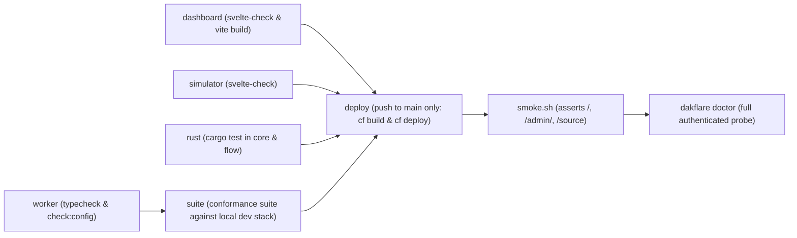

# DakFlare — Master System Specification & Repository Reference

> **Revision:** 6.1.0 P0 (agent identity and blast radius · Corrected against the code)  
> **Component Versions:**
> - Worker: `6.1.0` (`worker/package.json`, and `worker/src/lib/version.ts`, which is what `/v1/admin/health` reports)
> - CLI (`dakflare`): `6.1.0` (`cli/bin/dakflare.js`)
> - Root Package: `6.1.0` (`package.json`)
> - Web Console: `6.1.0`, Svelte 5.57, SvelteKit 3.0 (`dashboard/package.json`)
> - Mobile Simulator: `6.1.0` (versionCode 610), Svelte 5.56, SvelteKit 2.65, Tauri v2 (`simulator/package.json`, `simulator/src-tauri/tauri.conf.json`)
> - Wire Protocol: `PROTOCOL_CONTRACT_V5.md` (Frozen Rev E)
>
> **Authority Map:**
> - Wire Protocol Contract: `PROTOCOL_CONTRACT_V5.md`
> - Consolidated Database Schema: `worker/migrations/0001_baseline.sql`
> - v6 Enterprise & Hardening Schema: `worker/migrations/0002_v6_enterprise_and_hardening.sql`
> - v6.1 Agent Control Plane Schema: `worker/migrations/0003_agent_control_plane.sql`
> - Deployment & Operations: `docs/OPS_DEPLOY.md` and `docs/OPS_BACKUP.md`
> - Agent Skills: `skills/dakflare-provision/`, `skills/dakflare-messaging/`, `skills/dakflare-flows/`
> - Coding Agent Guidelines: `AGENTS.md`
>
> **What 6.0.0 changed, in one line:** the command handoff is now an exclusive,
> 60 s, token-bearing **lease**, the device acknowledges **after** `SmsManager`
> accepts the message, acks are objects, and `ACKED_BY_DEVICE` is gone. See §4.3.
>
> **What 6.1.0 P0 adds, in one line:** a third credential type — an agent token —
> plus a **time-boxed authority grant** that bounds what it may actually do. An
> agent may *ask*; a human decides for how long, and over which recipients. See §4.4.

---

## 1. System Architecture & Component Topology

DakFlare is a sovereign, zero-telecom-SaaS SMS gateway pairing a dedicated physical Android handset with a Cloudflare serverless edge (Workers, Durable Objects, D1, KV).

The central thesis: **The phone is the radio; the Worker is the coordinator.**

```
┌────────────────────────────────────────────────────────────────────────────────────────────────────────┐
│                                          OPERATOR TIER                                                 │
│                                                                                                        │
│   ┌─────────────────────────────────────────────────┐   ┌──────────────────────────────────────────┐   │
│   │           Web Console (/admin)                  │   │            CLI (dakflare)                │   │
│   │   - Svelte 5.57, SvelteKit 3.0 (Prerendered)    │   │   - Zero-dependency Node.js 22+          │   │
│   │   - FIDO2 / WebAuthn Passkeys                   │   │   - Machine token with X-Dakflare-Client │   │
│   │   - TOTP Authenticator (RFC 6238)               │   │   - Built-in terminal QR generator       │   │
│   │   - Client-side PBKDF2 (AUTH_PASSWORD_MODE)     │   │   - Idempotency key replay protection    │   │
│   │   - Warm cream token design (design/tokens.css) │   │   - Semantic exit codes (0, 1, 2, 3..75) │   │
│   └────────────────────────┬────────────────────────┘   └────────────────────┬─────────────────────┘   │
└────────────────────────────┼─────────────────────────────────────────────────┼─────────────────────────┘
                             │ HTTPS (Session Cookie dakflare_admin)           │ HTTPS (Bearer + Client Header)
                             ▼                                                 ▼
┌────────────────────────────────────────────────────────────────────────────────────────────────────────┐
│                                    CLOUDFLARE EDGE TIER                                                │
│                                                                                                        │
│   [worker/src/index.ts] (Global V8 Isolates) ──► [worker/src/auth-guard.ts] (AuthGuard Durable Object) │
│            │                                      Global sliding-window lockout (auth_windows table)   │
│            ├─────────────────────────────────────────┬─────────────────────────────────────────────────┤
│            ▼                                         ▼                                                 ▼
│   [Cloudflare D1]                             [Cloudflare KV]                   [DeviceGateway DO]     │
│   Database: sms_gateway                       Cache: KV                         One instance per phone │
│   0001_baseline.sql (17 tables)               FCM OAuth2 Bearer Access Token    - SQLite Command Queue │
│   0002_v6_enterprise (+5 tables,              (Google Service Account JWT)      - Lease state machine  │
│   3 columns) = 22 tables: messages,                                             - Replay Nonces Table  │
│   devices, rules, workflows, user,                                              - Alarms (lease/offln) │
│   passkey, alerts, rule_hits, webhooks,                                         - WebSocket Server     │
│   integration_deliveries, device_sims, etc.)                                                           │
└────────────┬─────────────────────────────────────────┬──────────────────────────────────▲──────────────┘
             │                                         │                                  │
             │                                         ▼                                  │ Signed Wire
             │                                  [Google FCM HTTP v1]                      │ Protocol
             │                                  High-priority silent wake                 │ (P-256 IEEE P1363)
             │                                  Payload: { "wake": 1 } (Zero PII)         │
             ▼                                         │                                  │
┌──────────────────────────────────────────────────────┼──────────────────────────────────┴──────────────┐
│                                       HANDSET & RADIO TIER                                             │
│                                                      ▼                                                 │
│   [Android Handset (Tauri v2 + Rust Core)] ◄─────────┘                                                 │
│   - Role: android.app.role.SMS (Default Messaging App owns content://sms provider write path)          │
│   - Identity: Non-exportable P-256 Key wrapped by Android KeyStore (keystore:v1:<iv>:<ct>)             │
│   - Background: GatewayService (persistent gateway loop) & RespondViaMessageService                    │
│   - Dedicated WebSocket Client (simulator/src-tauri/src/socket.rs): real-time command delivery (~3.5s) │
│   - Embedded libSQL Store (simulator.db): immediate local durability before network transmission       │
│   - Dual-Target Flow Engine: Native Rust (Phone) & WebAssembly flow.wasm (Edge)                        │
└──────────────────────────────────────────────────────┬─────────────────────────────────────────────────┘
                                                       │ GSM 03.38 (GSM-7) / UCS-2 Cellular Radio
                                                       ▼
┌────────────────────────────────────────────────────────────────────────────────────────────────────────┐
│                                     EXTERNAL TELEPHONY TIER                                            │
│                                                                                                        │
│   [Peer Mobile Handset]  ◄───────────►  [Cellular Tower / SMSC Carrier Network]                        │
└────────────────────────────────────────────────────────────────────────────────────────────────────────┘
```

---

## 2. Architectural Evolutions (Consolidation and the 6.0.0 Lease Cutover)

The codebase underwent a major architectural cleanup and hardening during the PR #1 consolidation:

1. **`AUTH_MODE=legacy` Retired:**
   - The unauthenticated bearer-only `ADMIN_TOKEN` path was removed.
   - The admin gate now accepts exactly two credentials:
     - A valid Better Auth session cookie (`dakflare_admin`) with role `owner` or `admin`.
     - An `ADMIN_TOKEN` bearer carrying the explicit header `X-Dakflare-Client: cli`.
   - Raw bearer requests without the client header return `401 unauthorized`.
2. **Consolidated Baseline Migration:**
   - Eleven incremental migrations were merged into a single authoritative [`0001_baseline.sql`](file:///home/jony/Projects/dakflare/worker/migrations/0001_baseline.sql).
   - Parity is verified via [`worker/scripts/verify-baseline.sh`](file:///home/jony/Projects/dakflare/worker/scripts/verify-baseline.sh) by comparing `sqlite_master` dumps against production D1.
3. **Rules Engine Unified into the Flow Engine:**
   - `worker/src/rules/evaluate.ts` was deleted.
   - All rules in the `rules` table compile at save-time via [`worker/src/lib/rule-graph.ts`](file:///home/jony/Projects/dakflare/worker/src/lib/rule-graph.ts) into standard Flow DAG nodes:
     $$\text{trigger} \to \text{sender} \to \text{masked} \to \text{body} \to \text{extract} \to \text{shortcode} \to \text{send} \to \text{stop}$$
   - Rules run in the Worker only: they are an online feature, evaluated while the batch syncs ([`routes/incoming.ts`](file:///home/jony/Projects/dakflare/worker/src/routes/incoming.ts) calls [`lib/rule-graph.ts`](file:///home/jony/Projects/dakflare/worker/src/lib/rule-graph.ts)). The phone syncs **workflows**, not rules, and runs those natively. Both sides interpret the same graph format from the same Rust source, so a matcher means the same thing wherever it runs.
4. **Dedicated Handset WebSocket Client:**
   - [`simulator/src-tauri/src/socket.rs`](file:///home/jony/Projects/dakflare/simulator/src-tauri/src/socket.rs) implements a persistent blocking WebSocket client in Rust (`tungstenite` + `rustls`).
   - Outbound SMS dispatch latency dropped from **37–107 seconds (polling)** to **~3.5 seconds (live socket push)**. HTTP poll remains as a 5-minute backstop.
5. **Self-Resolving Offline Alerts:**
   - When a handset disconnects or misses an alarm, an `offline_alert` is raised in `alerts`.
   - As soon as the device reconnects or syncs an incoming batch, [`worker/src/routes/incoming.ts`](file:///home/jony/Projects/dakflare/worker/src/routes/incoming.ts) automatically sets `resolved_at = now`.
6. **Zero-Touch Cloud Provisioner (`dakflare up`):**
   - An idempotent provisioning command driving the Cloudflare `cf` CLI that creates D1, KV, applies migrations, deploys the Worker, and bootstraps the initial owner account.
7. **Semantic CLI Exit Codes & Unified JSON Envelope:**
   - Every CLI command outputs a strict envelope with `status: "ok" | "error"`.
   - Error categories live under `error.category` (`"usage"`, `"tooling"`, `"not_found"`, `"permission"`, `"conflict"`, `"precondition"`, `"temporary"`, `"internal"`).
   - Exit codes: `0` ok, `1` failed, `2` usage, `3` not found, `4` permission, `5` conflict, `6` precondition, `75` temporary (in flight).
8. **Exclusive Command Lease (6.0.0, the one deliberate protocol break):**
   - The read-then-mark handoff is gone. A command is claimed by a single `UPDATE … RETURNING` that sets `state = 'LEASED'`, a per-row `claim_token` and `lease_until`, so a WebSocket push and an HTTP poll racing for the same command cannot both receive it. See §4.3.
   - `ACKED_BY_DEVICE` is deleted. The machine is `PENDING → LEASED → DISPATCHED → SENT → DELIVERED` (+ `FAILED`, `EXPIRED`), and the two old values moved: 5.x `DISPATCHED` is now `LEASED`, 5.x `ACKED_BY_DEVICE` is now `DISPATCHED`.
   - The device acknowledges **after** `SmsManager` returns, and the ack carries the token it was leased with. The lease is 60 s (`LEASE_MS`) precisely because a real send outlasts an 8 s handshake.
   - Acks are objects (`acks: [{command_id, claim_token}]`) on both transports. A body carrying `ack_command_ids` is refused with `400 bad_request` rather than ignored, so a v5.2.1 phone fails loudly instead of churning leases while it believes it acknowledged.
   - Worker and handset ship together. There is no shim, by decision: a shim would keep two meanings of `DISPATCHED` alive in one deployment.

---

## 3. Cryptographic Contract & Authentication Architecture

### 3.1 Signed Request Protocol (PROTOCOL_CONTRACT_V5 Rev E)

Signed device requests to the Worker must carry:
* `X-Device-Id`: `/^[A-Za-z0-9_-]{8,64}$/`
* `X-Timestamp`: Exactly 13 decimal digits (UTC ms), validated within $\pm 300\text{ s}$ ($5\text{ min}$) window.
* `X-Nonce`: Exactly 32 lowercase hex characters (128-bit random).
* `X-Signature`: Base64-encoded raw IEEE P1363 ECDSA signature (64 bytes).

**Canonical String Formulation:**
```
METHOD\nPATH\nTS\nNONCE\nBODY_SHA256
```
- No query string allowed (`url.search === ""`). Non-empty query returns `400 unexpected_query`.
- For `GET`/`HEAD`, `BODY_SHA256` is `e3b0c44298fc1c149afbf4c8996fb92427ae41e4649b934ca495991b7852b855` (`SHA-256("")`).

### 3.2 Canonical Protocol Test Vectors (`test-support/protocol-vectors.json`)

| Vector ID | Method | Path | Timestamp | Nonce | Body SHA-256 |
|---|---|---|---|---|---|
| **A** | `POST` | `/v1/sms/outgoing/poll` | `1776470400000` | `a3f1c0d29b7e4f8a1c6d5e2b9f0a7c34` | `f8c6ca3e8d50126cc59e541a6644ef1db7c3eec01b155a8310dea13143b9f0a9` |
| **B** | `GET` | `/v1/device/ws` | `1776470400000` | `0f1e2d3c4b5a69788796a5b4c3d2e1f0` | `e3b0c44298fc1c149afbf4c8996fb92427ae41e4649b934ca495991b7852b855` |
| **C** | `POST` | `/v1/sms/incoming/batch` | `1776470400000` | `deadbeefcafebabe0123456789abcdef` | `1459860ca2b1d0a6e64d93d02246fb1f6c04d574b75bcdd485881d5830486fc6` |

**These vectors pin the SIGNING computation, which Rev E did not change.** The canonical string (§2), the header grammars (§1.1) and the signature encoding (§3) are byte-identical, so an already-written client still signs correctly. Vector A's sample body still reads `ack_command_ids` and is **not** the body to send: the live ack key is `acks`, and a request carrying `ack_command_ids` is refused with `400 bad_request`. The vector is deliberately not regenerated, because regenerating it would churn three independent implementations (Worker, Rust, harness) to prove something no consumer of the vectors depends on.

### 3.3 The Four Authentication Factors

DakFlare implements four operator authentication factors:

1. **Passkeys (Primary):** FIDO2 / WebAuthn credentials via `@better-auth/passkey`. Authenticated against origin `rpId` with challenge verification, counter check, and user presence validation.
2. **TOTP Authenticator (RFC 6238):** Standard HMAC-SHA1 30-second time-step with 6 decimal digits. Enrolment yields 10 single-use recovery codes (the plugin default), stored encrypted in `twoFactor.backupCodes` rather than in the clear.
3. **Password (`AUTH_PASSWORD_MODE`):**
   - `client-derived` (set in `cloudflare.config.ts`): Browser Web Worker runs 210,000 PBKDF2-SHA256 iterations on the user password + salt. Worker applies server-side HMAC pepper + SHA-256. Protects the Worker's $10\text{ ms}$ CPU limit. With the variable unset the mode is `off`, which disables the factor entirely.
   - `server-kdf`: Runs PBKDF2 server-side (only for paid Workers plans with unbounded CPU).
   - Dual-pepper ring: `AUTH_PEPPER="v2:<b64>,v1:<b64>"` allows seamless pepper rotation.
4. **Magic Link:** `POST /v1/auth/magic-link` unconditionally returns `202 accepted` (preventing account enumeration). Single-use token hash stored in `magic_link`; delivered through Resend when `RESEND_API_KEY` is a Worker secret. Without it the factor is advertised as unavailable (`magic_link: false`) and the request still answers `202`, so a missing mail sender is not observable to an attacker.

### 3.4 Invites and the Lockout (Not Authentication Factors)

These protect account creation and sign-in. Neither is something an operator signs in with.

- **Invite Flow:** Strictly invite-only. `POST /v1/admin/invites` mints single-use tokens; the raw token is printed once, and only its SHA-256 hash is persisted in `invite`.
- **Global Failed-Auth Lockout:** [`AuthGuard`](file:///home/jony/Projects/dakflare/worker/src/auth-guard.ts) Durable Object tracks failed sign-in attempts by IP and account in its `auth_windows` table. 5 failures within 15 minutes triggers an isolate-independent 15-minute lockout (`429 rate_limited`).

---

## 4. Complete Data Models & Storage Contracts

### 4.1 Cloudflare D1 Relational Schema

Two migrations, applied in order. `0001` is the consolidated baseline (17 tables,
dumped from production and verified against it); `0002` is the v6 additive layer
(5 tables, 3 columns), so a v5.2.1 Worker keeps running against the same database.

#### 4.1.1 `worker/migrations/0001_baseline.sql` — all 17 tables

```sql
-- 1. Operator Accounts
CREATE TABLE account (
  id                     text PRIMARY KEY NOT NULL,
  "accountId"            text NOT NULL,
  "providerId"           text NOT NULL,
  "userId"               text NOT NULL REFERENCES "user"(id) ON DELETE CASCADE,
  "accessToken"          text,
  "refreshToken"         text,
  "idToken"              text,
  "accessTokenExpiresAt" date,
  "refreshTokenExpiresAt" date,
  scope                  text,
  password               text,
  "createdAt"            date NOT NULL,
  "updatedAt"            date NOT NULL
);

-- 2. System Alerts (Load-bearing for alert resolution)
CREATE TABLE alerts (
  id              TEXT PRIMARY KEY NOT NULL,
  device_id       TEXT NOT NULL,
  kind            TEXT NOT NULL,
  raised_at       INTEGER NOT NULL,
  acknowledged_at INTEGER,
  detail          TEXT,
  resolved_at     INTEGER
);

-- 3. Audit Log
CREATE TABLE audit_log (
  id          text PRIMARY KEY NOT NULL,
  at          integer NOT NULL,
  actor_user  text,
  actor_label text,
  action      text NOT NULL,
  subject     text,
  ip          text,
  user_agent  text,
  detail_json text
);

-- 4. Handset Fleet Registry
CREATE TABLE devices (
  device_id   TEXT PRIMARY KEY,
  public_key  TEXT NOT NULL,
  fcm_token   TEXT,
  paired_at   INTEGER NOT NULL,
  last_seen   INTEGER NOT NULL,
  label       TEXT,
  sim_slot    INTEGER,
  archived_at INTEGER
);

-- 5. Flow Execution Records
CREATE TABLE flow_runs (
  device_id    TEXT NOT NULL,
  local_id     TEXT NOT NULL,
  flow_id      TEXT NOT NULL,
  flow_version INTEGER NOT NULL,
  outcome      TEXT NOT NULL,
  created_at   INTEGER NOT NULL,
  PRIMARY KEY (device_id, local_id, flow_id, flow_version)
);

-- 6. Operator Invites
CREATE TABLE invite (
  id         text PRIMARY KEY NOT NULL,
  email      text NOT NULL,
  role       text NOT NULL,
  token_hash text NOT NULL UNIQUE,
  expires_at integer NOT NULL,
  used_at    integer,
  created_by text,
  created_at integer NOT NULL
);

-- 7. Magic Links
CREATE TABLE magic_link (
  id         text PRIMARY KEY NOT NULL,
  email      text NOT NULL,
  token_hash text NOT NULL UNIQUE,
  expires_at integer NOT NULL,
  used_at    integer,
  created_at integer NOT NULL,
  ip         text
);

-- 8. Messages Ledger (Inbound & Outbound)
CREATE TABLE messages (
  id               TEXT PRIMARY KEY NOT NULL,
  device_id        TEXT NOT NULL,
  local_id         TEXT NOT NULL,
  direction        TEXT NOT NULL CHECK (direction IN ('in', 'out')),
  peer             TEXT NOT NULL,
  body             TEXT NOT NULL,
  received_at      INTEGER NOT NULL,
  auto_reply       INTEGER NOT NULL DEFAULT 0,
  reply_source     TEXT,
  reply_ref        TEXT,
  reply_command_id TEXT,
  reply_state      TEXT,
  reply_error      TEXT,
  UNIQUE(device_id, local_id)
);

-- 9. Pairing Codes
CREATE TABLE pairing_codes (
  code       TEXT PRIMARY KEY,
  expires_at INTEGER NOT NULL,
  device_id  TEXT,
  purpose    TEXT NOT NULL DEFAULT 'enroll',
  claimed_at INTEGER
);

-- 10. Passkeys (WebAuthn / FIDO2)
CREATE TABLE passkey (
  id             text PRIMARY KEY NOT NULL,
  name           text,
  "publicKey"    text NOT NULL,
  "userId"       text NOT NULL REFERENCES "user"(id) ON DELETE CASCADE,
  "credentialID" text NOT NULL,
  counter        integer NOT NULL DEFAULT 0,
  "deviceType"   text NOT NULL,
  "backedUp"     integer NOT NULL DEFAULT 0,
  transports     text,
  "createdAt"    date,
  aaguid         text
);

-- 11. Rule Hits (Load-bearing for console per-rule statistics)
CREATE TABLE rule_hits (
  rule_id    TEXT NOT NULL,
  device_id  TEXT NOT NULL,
  replied_at INTEGER NOT NULL
);

-- 12. Automation Rules
CREATE TABLE rules (
  id              TEXT PRIMARY KEY NOT NULL,
  name            TEXT NOT NULL,
  enabled         INTEGER NOT NULL DEFAULT 1,
  priority        INTEGER NOT NULL DEFAULT 0,
  matcher_type    TEXT NOT NULL,
  matcher_value   TEXT NOT NULL,
  body_type       TEXT NOT NULL,
  body_value      TEXT NOT NULL,
  reply_template  TEXT NOT NULL,
  cooldown_s      INTEGER NOT NULL DEFAULT 60,
  max_per_hour    INTEGER NOT NULL DEFAULT 10,
  sim_slot        INTEGER NOT NULL DEFAULT 0,
  allow_shortcode INTEGER NOT NULL DEFAULT 0,
  device_id       TEXT,
  updated_at      INTEGER NOT NULL
);

-- 13. Operator Sessions
CREATE TABLE session (
  id          text PRIMARY KEY NOT NULL,
  "expiresAt" date NOT NULL,
  token       text NOT NULL UNIQUE,
  "createdAt" date NOT NULL,
  "updatedAt" date NOT NULL,
  "ipAddress" text,
  "userAgent" text,
  "userId"    text NOT NULL REFERENCES "user"(id) ON DELETE CASCADE
);

-- 14. Two-Factor TOTP Secrets & Recovery Codes
CREATE TABLE "twoFactor" (
  id                        text PRIMARY KEY NOT NULL,
  secret                    text NOT NULL,
  "backupCodes"             text NOT NULL,
  "userId"                  text NOT NULL REFERENCES "user"(id) ON DELETE CASCADE,
  verified                  integer DEFAULT 1,
  "failedVerificationCount" integer DEFAULT 0,
  "lockedUntil"             date
);

-- 15. Operator Users
CREATE TABLE "user" (
  id                 text PRIMARY KEY NOT NULL,
  name               text NOT NULL,
  email              text NOT NULL UNIQUE,
  "emailVerified"    integer NOT NULL DEFAULT 0,
  image              text,
  "createdAt"        date NOT NULL,
  "updatedAt"        date NOT NULL,
  "twoFactorEnabled" integer NOT NULL DEFAULT 0,
  role               text
);

-- 16. Verification Tokens
CREATE TABLE verification (
  id          text PRIMARY KEY NOT NULL,
  identifier  text NOT NULL,
  value       text NOT NULL,
  "expiresAt" date NOT NULL,
  "createdAt" date NOT NULL,
  "updatedAt" date NOT NULL
);

-- 17. Workflow Graphs
CREATE TABLE workflows (
  id         TEXT PRIMARY KEY,
  name       TEXT NOT NULL,
  enabled    INTEGER NOT NULL DEFAULT 1,
  device_id  TEXT,
  graph      TEXT NOT NULL,
  version    INTEGER NOT NULL DEFAULT 1,
  created_at INTEGER NOT NULL,
  updated_at INTEGER NOT NULL
);
```

#### 4.1.2 `worker/migrations/0002_v6_enterprise_and_hardening.sql` — 5 tables, 3 columns

Every statement is `CREATE … IF NOT EXISTS` or `ALTER TABLE … ADD COLUMN`, so
applying it twice is a no-op and a 5.x Worker that does not know these tables keeps
working. The Durable Object's SQLite is untouched by it: only D1.

```sql
-- 18. Webhook endpoints (dual-ring secret, "v2:whsec_…,v1:whsec_…")
CREATE TABLE IF NOT EXISTS webhooks (
  id                  TEXT PRIMARY KEY NOT NULL,
  name                TEXT NOT NULL,
  vertical            TEXT NOT NULL CHECK (vertical IN ('generic','ecommerce','finance','healthcare','education')),
  target_url          TEXT NOT NULL,
  enabled             INTEGER NOT NULL DEFAULT 1,
  events_json         TEXT NOT NULL,
  secret_ring         TEXT NOT NULL,
  custom_headers_json TEXT,
  timeout_ms          INTEGER NOT NULL DEFAULT 10000,
  max_attempts        INTEGER NOT NULL DEFAULT 8,
  device_id           TEXT REFERENCES devices(device_id) ON DELETE SET NULL,
  created_at          INTEGER NOT NULL,
  updated_at          INTEGER NOT NULL
);

-- 19. Webhook delivery ledger (UNIQUE idempotency_key is the retry guard)
CREATE TABLE IF NOT EXISTS integration_deliveries (
  id               TEXT PRIMARY KEY NOT NULL,
  webhook_id       TEXT NOT NULL REFERENCES webhooks(id) ON DELETE CASCADE,
  event_type       TEXT NOT NULL,
  idempotency_key  TEXT NOT NULL UNIQUE,
  payload_json     TEXT NOT NULL,
  state            TEXT NOT NULL DEFAULT 'PENDING' CHECK (state IN ('PENDING','DELIVERED','RETRYING','DEAD_LETTER')),
  attempts         INTEGER NOT NULL DEFAULT 0,
  next_attempt_at  INTEGER NOT NULL,
  last_http_status INTEGER,
  last_error       TEXT,
  delivered_at     INTEGER,
  created_at       INTEGER NOT NULL
);
CREATE INDEX IF NOT EXISTS idx_integration_deliveries_dispatch
  ON integration_deliveries(state, next_attempt_at);

-- 20. Financial ledger (money is integer minor units, never a float)
CREATE TABLE IF NOT EXISTS financial_transactions (
  id                  TEXT PRIMARY KEY NOT NULL,
  device_id           TEXT NOT NULL,
  message_id          TEXT NOT NULL REFERENCES messages(id) ON DELETE CASCADE,
  provider            TEXT NOT NULL,
  trx_id              TEXT NOT NULL,
  direction           TEXT NOT NULL CHECK (direction IN ('CRDT','DBIT')),
  amount_minor        INTEGER NOT NULL,
  currency            TEXT NOT NULL DEFAULT 'BDT',
  fee_minor           INTEGER NOT NULL DEFAULT 0,
  balance_after_minor INTEGER,
  counterparty        TEXT,
  status              TEXT NOT NULL DEFAULT 'UNCLAIMED' CHECK (status IN ('UNCLAIMED','CLAIMED','DISPUTED')),
  claimed_by_ref      TEXT,
  claimed_at          INTEGER,
  iso20022_json       TEXT NOT NULL,
  occurred_at         INTEGER NOT NULL,
  created_at          INTEGER NOT NULL,
  UNIQUE(provider, trx_id)
);
CREATE INDEX IF NOT EXISTS idx_fin_trx_lookup
  ON financial_transactions(trx_id, status);

-- 21. Interactive sessions (reply correlated by peer + code table)
CREATE TABLE IF NOT EXISTS interactive_sessions (
  id                  TEXT PRIMARY KEY NOT NULL,
  vertical            TEXT NOT NULL CHECK (vertical IN ('ecommerce','healthcare','education')),
  external_ref        TEXT NOT NULL,
  peer_e164           TEXT NOT NULL,
  device_id           TEXT NOT NULL,
  sim_slot            INTEGER NOT NULL DEFAULT 1,
  state               TEXT NOT NULL DEFAULT 'AWAITING_REPLY' CHECK (state IN ('AWAITING_REPLY','CONFIRMED','RESCHEDULE_REQUESTED','CANCELLED','EXPIRED')),
  expected_codes_json TEXT NOT NULL,
  metadata_json       TEXT NOT NULL,
  outbound_command_id TEXT,
  reply_message_id    TEXT,
  expires_at          INTEGER NOT NULL,
  resolved_at         INTEGER,
  created_at          INTEGER NOT NULL
);
CREATE INDEX IF NOT EXISTS idx_interactive_peer_active
  ON interactive_sessions(peer_e164, state, expires_at);

-- 22. Multi-SIM inventory (fixed-window token bucket per slot)
CREATE TABLE IF NOT EXISTS device_sims (
  device_id         TEXT NOT NULL REFERENCES devices(device_id) ON DELETE CASCADE,
  sim_slot          INTEGER NOT NULL CHECK (sim_slot IN (1,2)),
  subscription_id   INTEGER,
  carrier_name      TEXT,
  mcc_mnc           TEXT,
  msisdn_e164       TEXT,
  role_affinity     TEXT NOT NULL DEFAULT 'general' CHECK (role_affinity IN ('general','otp_high','bulk_edu','standby_failover')),
  max_per_hour      INTEGER NOT NULL DEFAULT 120,
  sent_current_hour INTEGER NOT NULL DEFAULT 0,
  hour_window_start INTEGER NOT NULL DEFAULT 0,
  consecutive_fails INTEGER NOT NULL DEFAULT 0,
  radio_state       TEXT NOT NULL DEFAULT 'READY' CHECK (radio_state IN ('READY','DEGRADED','NO_SERVICE','LOCKED')),
  updated_at        INTEGER NOT NULL,
  PRIMARY KEY (device_id, sim_slot)
);

-- Split-horizon bookkeeping. Defaults keep today's behaviour.
ALTER TABLE workflows ADD COLUMN execution_policy TEXT NOT NULL DEFAULT 'HYBRID_HANDSET_FIRST';
ALTER TABLE workflows ADD COLUMN source_kind      TEXT NOT NULL DEFAULT 'canvas';
ALTER TABLE flow_runs ADD COLUMN checkpoint_json  TEXT;
```

Two deliberate departures from the blueprint's DDL: money is `amount_minor` /
`fee_minor` integers with `UNIQUE(provider, trx_id)`, which is the double-credit
guard; and `source_kind` carries no `CHECK`, because `ALTER TABLE ADD COLUMN` with
a check is a foot-gun for existing rows and the column is read, not trusted.

`execution_policy` is read by the console and the handset to decide where a graph
runs. `HYBRID_HANDSET_FIRST` is the default so nobody's matching changes on
upgrade; a rule compiled from the rules form records `EDGE_ONLY`, because a rule
is an online feature. Operators change the policy per workflow from the console or
the app, which is why it is a column and not a build-time constant.

**Production state:** `0002` is applied locally and exercised by the suite, but not
yet applied to the production database. `dakflare doctor` reports it as the one
failing check until the manual migrations workflow runs, after a backup.

### 4.2 Durable Object SQLite Schemas

#### A. `DeviceGateway` DO (One Instance per Device)
```sql
CREATE TABLE IF NOT EXISTS devices (
  device_id       TEXT PRIMARY KEY,
  public_key_spki TEXT NOT NULL,
  fcm_token       TEXT,
  updated_at      INTEGER NOT NULL
);

CREATE TABLE IF NOT EXISTS nonces (
  nonce TEXT PRIMARY KEY,
  ts    INTEGER NOT NULL,
  exp   INTEGER NOT NULL
);
CREATE INDEX IF NOT EXISTS idx_nonces_exp ON nonces(exp);

CREATE TABLE IF NOT EXISTS commands (
  command_id      TEXT PRIMARY KEY,
  to_e164         TEXT NOT NULL,
  body            TEXT NOT NULL,
  priority        TEXT NOT NULL DEFAULT 'normal',
  state           TEXT NOT NULL DEFAULT 'PENDING',
  created_at      INTEGER NOT NULL,
  expires_at      INTEGER NOT NULL,
  idempotency_key TEXT,
  claim_token     TEXT,
  lease_until     INTEGER,
  sim_slot        INTEGER NOT NULL DEFAULT 0
);
CREATE INDEX IF NOT EXISTS idx_commands_state ON commands(state, priority, created_at);
CREATE INDEX IF NOT EXISTS idx_commands_dispatch
  ON commands(state, lease_until, priority, created_at);

CREATE TABLE IF NOT EXISTS scheduled_tasks (
  id       TEXT PRIMARY KEY,
  run_at   INTEGER NOT NULL,
  kind     TEXT NOT NULL,
  payload  TEXT,
  attempts INTEGER NOT NULL DEFAULT 0
);
CREATE INDEX IF NOT EXISTS idx_run_at ON scheduled_tasks(run_at);

CREATE TABLE IF NOT EXISTS dead_letters (
  id        TEXT PRIMARY KEY,
  kind      TEXT NOT NULL,
  payload   TEXT,
  attempts  INTEGER NOT NULL,
  failed_at INTEGER NOT NULL
);

CREATE TABLE IF NOT EXISTS write_budget (
  day  TEXT PRIMARY KEY,
  rows INTEGER NOT NULL
);
```

`scheduled_tasks.kind` is one of:

| Kind | Timer | What it does |
|---|---|---|
| `expire` | `expires_at` | `PENDING`/`LEASED` → `EXPIRED`. |
| `lease_expiry` | `now + LEASE_MS` (60 s) | Reverts its own lease to `PENDING`, closes the owning socket (1011), sends the wake push. Carries `claim_token`, so a re-leased command is left alone. |
| `ack_wake` | `now + ACK_TIMEOUT_MS` (8 s) | Closes the socket of a device that has not acked. **Never releases the lease**: releasing a command mid-send is what duplicates an SMS. Armed only when the command was pushed over a socket. |
| `offline_alert` | `OFFLINE_ALERT_MS` (15 min) | Raises and self-resolves `device_offline`. |

#### B. `AuthGuard` DO (Singleton Global Lockout Authority)
```sql
CREATE TABLE IF NOT EXISTS auth_windows (
  key          TEXT PRIMARY KEY,
  window_start INTEGER NOT NULL,
  count        INTEGER NOT NULL,
  locked_until INTEGER NOT NULL
);
CREATE INDEX IF NOT EXISTS idx_auth_windows_expiry
  ON auth_windows(locked_until, window_start);
```


### 4.3 The Command State Machine (Rev E)

The one behavioural contract every other part of the system reads.

```
PENDING ──claim──► LEASED ──ack(token)──► DISPATCHED ──SENT receipt──► SENT ──carrier report──► DELIVERED
   ▲                  │                        │                          │
   └──lease_expiry────┘                        └──────► FAILED ◄───────────┘

PENDING | LEASED ──expire timer──► EXPIRED

terminal: DELIVERED, FAILED, EXPIRED
```

| From | To | Trigger |
|---|---|---|
| `PENDING` | `LEASED` | atomic claim by a WS push or a poll |
| `LEASED` | `DISPATCHED` | device ack carrying the matching `claim_token` |
| `LEASED` | `PENDING` | `lease_expiry`, or a push that never reached the device |
| `PENDING`, `LEASED` | `EXPIRED` | `expire` timer |
| `DISPATCHED` | `SENT` | per-part `SENT` receipt |
| `DISPATCHED`, `SENT` | `FAILED` | send or delivery failure |
| `SENT` | `DELIVERED` | carrier report |

Terminal: `DELIVERED`, `FAILED`, `EXPIRED`. Everything else is a no-op that
returns success, because a late or duplicated receipt from Android is normal.

**Why a lease, and why 60 s.** The device acks after `SmsManager` accepts the
message, not when it writes the row locally. On a congested cell or during a
handover a send routinely takes longer than 8 s, so an 8 s lease would expire
mid-send, the command would be re-claimed by another transport, and the late ack
would be a no-op: a second real SMS. 60 s covers a normal send with room to spare
and is still short enough that a dead phone does not hold a command for long.

The residual case is stated rather than hidden: a send that somehow exceeds 60 s
will have its lease reverted and can be claimed again, and its late ack will then
be refused by the token guard. That is the same duplicate the lease is meant to
prevent, one order of magnitude rarer. A longer lease trades that for a longer
stall on a phone that has died mid-send; 60 s is the chosen point on that curve.

**A lost push recovers at lease expiry, not at the drain.** A frame written to a
half-open socket is never seen by the phone, and the edge cannot tell that from a
slow send. So the recovery is deliberately two-staged: `ack_wake` closes the
silent socket at 8 s (which provokes a reconnect) and does **not** release the
lease, and when `lease_expiry` fires at 60 s it reverts the command **and hands it
back to the device immediately**, with a fresh `claim_token` so the previous
holder's late ack cannot apply.

That re-delivery is safe for the same reason the 60 s figure is: the lease is the
bet that no send outlives it, so at expiry the first attempt is over or never
started. Without it the command waited for the handset's five-minute drain, which
is what an end-to-end run actually measured (90 s through a reconnect, and one
command that waited out the full drain). `pushCommands` also tries every socket
that is not already CLOSING or CLOSED, because the socket a frame was written to
is not always the one the device is reading.

**The claim is one statement**, so two transports cannot both win it:

```sql
UPDATE commands
   SET state = 'LEASED',
       claim_token = lower(hex(randomblob(16))),
       lease_until = ?
 WHERE command_id IN (
   SELECT command_id FROM commands
    WHERE (state = 'PENDING' OR (state = 'LEASED' AND lease_until <= ?))
      AND expires_at > ?
    ORDER BY CASE priority WHEN 'high' THEN 0 WHEN 'normal' THEN 1 ELSE 2 END, created_at
    LIMIT ?
 )
RETURNING command_id, to_e164, body, priority, expires_at, claim_token, sim_slot;
```

**The ack is an object, on both transports**, and is the only transition a device
drives on its own, so it is the only one that requires proof of ownership:

```jsonc
// POST /v1/sms/outgoing/poll  and  POST /v1/sms/incoming/batch
{ "acks": [ { "command_id": "…", "claim_token": "…" } ] }

// WebSocket frame
{ "op": "ack", "acks": [ { "command_id": "…", "claim_token": "…" } ] }
```

The command payload carries the token it was claimed with:

```jsonc
{ "command_id": "…", "to": "+8801…", "body": "…", "priority": "normal",
  "expires_at": 1793000000000, "claim_token": "…", "sim_slot": 0 }
```

`sim_slot` is `0` for "no preference"; the phone falls back to its own device
setting, exactly as it did before the column existed. Nothing writes a preference
yet.

---

### 4.4 The Agent Control Plane (6.1.0 P0)

An autonomous caller is a third credential type, not a fifth role. It holds a
**scope** (what it may attempt) and needs a **grant** (what it may actually do,
until when, over what) before anything that costs money or interrupts traffic.

#### 4.4.1 Tokens

```
dkf_agt_<id>_<secret>
   id      16 lowercase hex, stored plainly: the lookup key, and what a human
           names when revoking.
   secret  32 random bytes, base64url. Stored ONLY as SHA-256 hex.
```

A plain digest is correct here and a password KDF would be wrong: the secret is
256 bits of CSPRNG output with no structure to guess, so there is no dictionary to
attack, and the comparison is over a fixed 32 bytes. The raw value is returned
once by the mint and never stored, logged or listed.

`agent_tokens` also carries the token's own **fixed hourly send budget**
(`max_per_hour`, default 20; `sent_current_hour` + `hour_window_start`). It is a
fixed window rather than a token bucket, deliberately: one row, one conditional
`UPDATE`, no drift, and no dependence on when the previous window happened to
roll. The spend is `UPDATE … WHERE id = ? AND (window expired OR sent < max)`,
read back through `meta.changes` — the same shape the Durable Object's
`write_budget` uses, for the same reason.

#### 4.4.2 Scopes and grants

`SCOPE_FOR_ACTION` (`worker/src/lib/agent-scopes.ts`) maps each admin route's
audit action to the scope an agent needs. A route absent from that table is
invisible to agents — the safe default for a route added later. `revoke` and
`auth reset` are not in `TOKEN_SCOPES` at all, so no token can hold them and no
grant can add them: the refusal is structural.

An **authority grant** is a lease, in the same spirit as the command lease:

| Column | Meaning |
|---|---|
| `scope`, `target_json` | one permission, over recipients / a device / a flow / a rule |
| `granted_by`, `granted_at` | a human, a moment |
| `expires_at` | absolute; every check is `expires_at > now` |
| `revoked_at` | revoked is a timestamp, not a delete |
| `use_count`, `last_used_at` | what the grant actually did |

The ladder an operator may pick from is **1 m, 5 m, 15 m, 30 m, 1 h, 1 d, 7 d,
30 d**; anything else snaps to the nearest rung (ties go shorter), then the
scope's ceiling applies:

| Scope | Max TTL | Target must name |
|---|---|---|
| `sms:send:production` | **1 h** | the recipients or the device |
| `enable_shortcode` | 15 m | one rule or flow |
| `dlq_bulk_replay` | 15 m | one device |
| `flow_deploy_prod` | 1 d | one flow |
| `rules:write`, `webhooks:write` | 1 d | — |
| read scopes | 30 d | — |
| `devices:revoke`, `auth:reset` | never | a human credential only |

A request that is clamped says so: the response carries `requested_s`,
`granted_s`, `clamped` and `max_s`. Silently shortening a grant is how an
operator learns to distrust the tool.

#### 4.4.3 The send decision

Order matters, and each step is one statement:

1. **Target.** A token bound to a handset may only use it.
2. **Grant.** A live `sms:send:production` grant whose target covers every
   recipient (a batch requires ALL of them, not one).
3. **Grant use.** One conditional `UPDATE … WHERE revoked_at IS NULL AND
   expires_at > ?`; `meta.changes == 0` is the refusal.
4. **Budget.** One conditional `UPDATE` against the token's hourly window.

No grant is an **approval request**, not a refusal: `202` with
`{"error":"approval_required","sent":false,"state":"PENDING","approval_request":{…}}`,
carrying the scope, the target, the ladder and the ceiling. The uniqueness key is
`(token, scope, target)`, so a retry loop gets the same request instead of
flooding the operator. A spent budget is `429 agent_quota_exceeded`.

`authority_grants` and `approval_requests` are human-only surfaces: they are
absent from `SCOPE_FOR_ACTION`, so an agent cannot approve its own request.

#### 4.4.4 Expiry

D1's `expires_at` check is the only thing that can ever grant access, so a grant
is unusable the millisecond its window closes with or without help. The
`AuthorityGuard` Durable Object (one object named `"global"`, mirroring
`AuthGuard`) owns a timer per grant so the window also *closes observably*: it
writes the `authority.expired` audit row on time even if no request touches the
deployment, and it is where a console or handset notification will hang off. A
timer that fires late, or not at all, costs an audit row and nothing else.

Every use is audited: `message.sent` carries `grant_id` in its detail, so "what
did that 15-minute grant actually do" is a query rather than a reconstruction.

---

### 4.5 The Canonical Flow IR (6.1.0 P1)

A flow is now one document, `dakflare.flow/v2`, with one validator per runtime
(`simulator/flow/src/ir.rs` and `worker/src/lib/flow-ir.ts`) and one shared vector
file (`test-support/flow-ir-vectors.json`) that both are tested against. Before
this, the Worker, the canvas and the interpreter each had their own opinion and
agreed by coincidence.

#### 4.5.1 Nine kinds

| Kind | `data` | Outgoing edges |
|---|---|---|
| `trigger` | `{ kind: "incoming", sender?, body? }` | 1 |
| `extract` | `{ source, pattern, flags? }`, at least one `(?<name>...)` | 1 |
| `set_var` | `{ name, value }` | 1 |
| `condition` | `{ left, op, right? }` | 2: `true`, `false` |
| `switch` | `{ value, cases: string[] }` | 1 per case (`case:0` …) + `default` |
| `delay` | `{ seconds }`, 1 to 300 | 1 |
| `webhook` | `{ url, body }`, https only | 1 |
| `send_sms` | `{ to, body }` | 1 |
| `stop` | `{ reason? }` | 0 |

`delay`, `webhook` and `send_sms` are **actions**, not effects: the interpreter
returns them in visit order and the caller owns the clock, the network and the
radio. That is what keeps a trace deterministic and identical on the phone, in
the Worker's WASM fallback, and in `dakflare rules test`.

Both performers that cannot execute one of those say so out loud rather than
falling through: the handset logs that it skips `delay` and `webhook` (it runs
flows synchronously and makes no outbound calls) and the Worker's dispatch logs
the same. A flow that uses one runs partially, visibly.

#### 4.5.2 What the validator refuses

- A cycle, naming the **edge and the node** it returns to.
- A node reachable from nothing, and more than one trigger.
- A branch handle on a node that does not branch, or a missing one on a node that
  does.
- `{{name}}` (or `{{vars.name}}`) where `name` is not bound on **every** path into
  that node. `set_var` and `extract` bind; the analysis is a forward dataflow
  whose answer at a node is the intersection over its predecessors, so a value
  that exists on the branch the author was thinking about is refused rather than
  rendered as an empty string.

#### 4.5.3 Layout is data

`ui_layout` is optional on the way in and always computed on the way out:

```
algorithm  "rank-v1"
positions  { [nodeId]: { x, y } }     x = rank * 280, y = rowWithinRank * 160
```

A node's rank is its longest distance from the trigger, so the flow reads left to
right; the row is its sibling order, seeded by where its predecessors landed. The
same numbers come out of both runtimes, so the canvas does not jump when a graph
is re-saved, and a graph authored with no coordinates at all lands legibly.

The computed position is also copied onto `node.position` for v6.0 readers. That
mirror has a lifetime: `ui_layout` is authoritative.

#### 4.5.4 Concurrency

`expected_previous_version` is **one** conditional
`UPDATE … WHERE id = ? AND version = ?`, read back through `meta.changes`. D1
exposes no isolation level beyond a single statement plus atomic `batch()`, so a
SELECT-then-UPDATE would let two consoles read version 3 and both write 4. A lost
race is `409 version_conflict` naming the stored version.

---

### 4.6 By-example synthesis (6.1.0 P2)

An operator knows what the value looks like in two real messages. Writing the
pattern by hand means guessing the label, the separator and the shape of the
value, and being wrong in a way that surfaces three weeks later as a missing
extraction. `simulator/flow/src/prose_synth.rs` derives the pattern instead, and
proves it before returning anything.

```
1. locate    each expected value must occur EXACTLY ONCE in its body
2. anchor    walk back: separator run, then the label (a space inside two words
             stays part of the label, so "Txn ID" is one label)
3. reconcile different labels become a bounded alternation, whitespace as \s+
4. shape     common literal head and tail of the values, a character class in the
             middle, length bounds from what was seen
5. prove     compile, run against every sample, then every negative
```

A single example is generalised over its whole value rather than taken literally:
a pattern that can only ever match the message it came from is not an extraction
rule.

Refusals, each with a reason the caller can act on: `value_absent`,
`value_ambiguous` (the value occurs twice, so the span cannot be anchored),
`no_anchor` (nothing before the value), `too_many_anchor_variants` (the examples
describe more than one template), `pattern_invalid`, `verification_failed` (the
pattern does not extract the expected value from a sample) and `negative_matched`
(the pattern matches a body it must not).

Two bKash examples produce, and then verify:

```
(?:TrxID|Txn\s+ID)[\s:=]*(?<trx_id>DHK[A-Za-z0-9]{7})
```

with `precision 1.0` and `recall 1.0` on the samples given, and zero matches on
the negative corpus. Those numbers are measured, not claimed: they are the result
of running the compiled pattern over the corpus it was handed.

The engine is `flow.wasm`, so `dakflare extract synthesize` runs offline against
the same binary the Worker executes. `--verify-d1-limit <n>` additionally runs the
pattern over the last n inbound messages of a deployment; history has no expected
value, so that reports **how many bodies matched**, never whether the match was
right, and it says so.

---

### 4.7 Provenance: one id, one verdict (6.1.0 P3)

A reply goes wrong across four stores and the operator sees one symptom: the
message was not answered. `dakflare trace <id>` joins them and reduces them to one
of seven verdicts plus the lines that justify it.

| Verdict | Means | Derived from |
|---|---|---|
| `replied` | the radio accepted the reply | command state `SENT`/`DELIVERED` |
| `queued` | a reply exists, not yet accepted | `PENDING`/`LEASED`/`DISPATCHED` |
| `failed` | the reply ended dead | `FAILED`/`EXPIRED` |
| `suppressed_cooldown` | a rule matched, its cooldown was open | **recorded at decision time** |
| `suppressed_hourly_cap` | a rule matched, its cap was spent | **recorded at decision time** |
| `no_match` | automation ran, nothing matched | the absence of all of the above |
| `paused_hitl_approval` | an agent asked, nobody has answered | `approval_requests` |

Six of the seven are derivable at read time. The two suppressions are not: a
cooldown is measured against `now`, so re-evaluating an hour later answers "would
reply", which is the opposite of what happened. `0004_provenance.sql` adds
`messages.reply_verdict` and `reply_verdict_detail_json`, written by the rule
pipeline at the moment of the decision, and holding only those two values.

The id may be a message, a command or an approval request. That order matters: an
approval request is the only one of the three that is a question rather than a
record, and "this is paused for a human" has no message row to derive from.

The device's Durable Object answers `/__trace?id=` with the command, the timers
armed for it, the dead letters it left, and its sockets. One request, because
those four things exist only there and a cached answer would describe a moment
that has passed. `reply-fate-trace.ts` joins that with D1 and `audit_log`.

The same object answers `/__dlq` and `/__ws`, which are the `dakflare dlq` and
`dakflare ws inspect` verbs. Socket inspection reports the same liveness evidence
the push path uses to decide a socket is stale, so the two cannot disagree about
what "quiet" means.

---

## 5. Operations, Deployment & CI/CD (`docs/OPS_DEPLOY.md`)

### 5.1 The Two Configurations (Canonical vs Tooling)

The project maintains two configuration files that **must never drift**:

| Configuration File | Consumed By | Purpose |
|---|---|---|
| `worker/cloudflare.config.ts` | `cf` CLI | **Canonical Worker definition:** bindings, DO exports, triggers, and deployment config. Used in CI deploy. |
| `worker/wrangler.toml` | `wrangler` CLI | **Developer tooling:** local dev (`wrangler dev --local`), log streaming (`wrangler tail`), secrets (`wrangler secret put`), D1 exports. |

- **Drift Enforcement:** `npm run check:config` ([`worker/scripts/check-config.mjs`](file:///home/jony/Projects/dakflare/worker/scripts/check-config.mjs)) is executed in CI on every pull request and every push to `main`. It verifies that binding names, rate limiters, and environment variables match exactly across `cloudflare.config.ts`, `wrangler.toml`, and `wrangler.account.toml`.

### 5.2 CI/CD Pipeline (`.github/workflows/pipeline.yml`)

Runs on every pull request and on pushes to `main`. Consists of six jobs. Four run in parallel; `suite` waits for `worker`, and `deploy` waits for all five:



1. **`worker`:** `tsc --noEmit` and `npm run check:config`.
2. **`dashboard`:** `svelte-check` and SvelteKit static asset build.
3. **`simulator`:** `svelte-check` for mobile UI.
4. **`rust`:** `cargo test --locked` across `simulator/core` (89 tests) and `simulator/flow` (8 tests).
5. **`suite`:** Starts local development stack (`wrangler dev --local`) and runs `dakflare_test_harness.mjs pair && suite`. The stack shortens the timing knobs through `--var` (`LEASE_MS=1500`, `ACK_TIMEOUT_MS=1500`, `OFFLINE_ALERT_MS=5000`), so the run does not wait a real minute for a lease to expire.
6. **`deploy`:** Only runs on pushes to `main` or manual dispatch. Builds console, runs `cf build` and `cf deploy --prebuilt`, executes `smoke.sh`, and verifies edge health via `dakflare doctor`.

### 5.3 Manual Migrations Workflow (`.github/workflows/migrations.yml`)

- Migrations are **never** applied automatically by the deploy pipeline.
- Applied manually via GitHub Actions workflow dispatch with explicit confirmation input `confirm: "apply"`.
- Production schema verification: [`worker/scripts/verify-baseline.sh`](file:///home/jony/Projects/dakflare/worker/scripts/verify-baseline.sh) diffs `sqlite_master` against `0001_baseline.sql`. Note: requires live Cloudflare credentials and cannot run offline in CI.

### 5.4 Post-Deploy Smoke Test ([`worker/scripts/smoke.sh`](file:///home/jony/Projects/dakflare/worker/scripts/smoke.sh))

Asserts edge routing without requiring credentials:
- `GET /`: Returns HTTP 200 and $> 1000\text{ bytes}$ (validating static assets were deployed rather than returning a 200 Worker 404).
- `GET /admin/`: Returns HTTP 200 (console shell entry).
- `GET /source`: Returns HTTP 302 redirect to the git repository (AGPL-3.0 §13 compliance).

### 5.5 Credentials, Forks and the Phone Build

**Who authenticates as what.** `cf auth login` is a browser approval and cannot run unattended, so there are two paths:

| Caller | Credential | Where it comes from |
|---|---|---|
| A person | `cf` session | `cf auth login` once; `dakflare up` then drives `cf` |
| GitHub Actions | `CLOUDFLARE_API_TOKEN` + `CLOUDFLARE_ACCOUNT_ID` | repository secrets |

The deploy job needs `CLOUDFLARE_API_TOKEN` with Workers Scripts:Edit, D1:Edit, Workers KV Storage:Edit and Account Settings:Read, plus `CLOUDFLARE_ACCOUNT_ID`. `ADMIN_TOKEN` is optional and only enables the post-deploy `doctor` step; without it that step is skipped and the deploy still succeeds.

`ADMIN_TOKEN` is not a Cloudflare credential. It is the Worker's own bearer secret, checked on `/v1/admin/*`, and `cf deploy` never sends it.

**Worker secrets** are not managed by the pipeline. `ADMIN_TOKEN`, `BETTER_AUTH_SECRET`, `AUTH_PEPPER`, `RESEND_API_KEY` and `FCM_SERVICE_ACCOUNT_JSON` are set once with `npx wrangler secret put <NAME> --name dakflare-worker` (or uploaded from `worker/.dev.vars` by `dakflare up`) and survive a deploy.

**Forks.** `cloudflare.config.ts` carries this account's D1 and KV ids, so the repository deploys only into the author's account. A fork copies `cloudflare.config.template.ts`, creates its own database and namespace, and pastes the ids in; `dakflare up` does that automatically.

**The phone is not built in CI.** The APK needs the NDK, JDK 21 and the release keystore, and is built locally:

```bash
cd simulator && npx tauri android build --apk --target aarch64
```

A release APK replaces cleanly because the signing certificate does not change, so pairing and the battery whitelist survive an install.

**Bump the version in two files, and clear the Gradle cache.** `bundle.android.versionCode` and `version` live in `simulator/src-tauri/tauri.conf.json`; `app/build.gradle.kts` reads that file at configuration time **without declaring it an input**, so a cached configuration serves the previous values. The build then reports success and produces an APK with the old `versionCode`, while `gen/android/app/tauri.properties` shows the new one, which is not read by the build. Clear it before rebuilding:

```bash
rm -rf simulator/src-tauri/gen/android/.gradle/configuration-cache \
       simulator/src-tauri/gen/android/app/.gradle
```

Verify the artefact, never the properties file:

```bash
$(ls ~/Android/Sdk/build-tools/*/aapt2 | tail -1) dump badging \
  simulator/src-tauri/gen/android/app/build/outputs/apk/universal/release/app-universal-release.apk | head -1
```

An installed APK must satisfy `adb shell dumpsys package dev.dakflare.simulator | grep versionCode`. A versionCode lower than the installed one is a downgrade and Android refuses it.

---

## 6. CLI Reference & Discovery Contract (`dakflare`)

### 6.1 Unified Envelope Format & Agent Mode

Every command output in `--json` and `--agent` mode adheres to this exact contract:

```json
{
  "schema_version": "1",
  "status": "ok",
  "command": "devices",
  "context": {
    "profile": "default",
    "cli_version": "6.1.0",
    "worker_url": "https://dakflare-worker.example.workers.dev"
  },
  "data": { ... },
  "verification": null,
  "warnings": []
}
```

* In case of error, `status` is `"error"`, and the `error` block is populated:
  ```json
  "error": {
    "code": "device_unknown",
    "category": "not_found",
    "message": "Device not registered in D1",
    "retryable": false,
    "safe_to_retry": false,
    "remediation": [{ "command": "dakflare devices", "description": "find the command id" }],
    "details": { "command_id": "…", "device_id": "dev…" }
  }
  ```

  `category` is one of `usage`, `tooling`, `not_found`, `permission`, `conflict`, `precondition`, `temporary`, `internal`. `remediation` is always an array of `{ command, description }`, and `details` carries the identifiers the failure was about.
* **`--agent` Mode Rules:**
  - Strictly single-line compact JSON.
  - ANSI colors are disabled.
  - A command that would need input returns `input_required` with exit `2` instead of prompting.

### 6.2 Semantic Exit Codes

| Code | Meaning | Context |
|---|---|---|
| `0` | Success | Operation succeeded or state settled. |
| `1` | Failed | Command failed, terminal state reached (`FAILED`/`EXPIRED`), check failed. |
| `2` | Usage | Malformed syntax, unknown flag, missing required argument. |
| `3` | Not Found | Device unknown, command ID unknown, missing route. |
| `4` | Permission | Invalid admin token, failed authentication, a scope the agent token does not hold (`forbidden`). |
| `5` | Conflict | Duplicate entry, race condition, an approval already decided (`not_pending`, `already_revoked`). |
| `6` | Precondition | No device paired, required prerequisite unfulfilled, `approval_required`, `agent_quota_exceeded`. |
| `75` | Temporary | Still in flight after wait timeout; network temporary failure. Safe to poll. |

Two of the `6` codes are `retryable: true` and also `safe_to_retry: true` even
though `send` is a mutating command: an `approval_required` and an
`agent_quota_exceeded` both mean the action did **not** happen, so repeating it
after a human answers cannot cause a second SMS.

### 6.3 Complete 22-Command CLI Matrix

| Command | Flags | Description & Semantics |
|---|---|---|
| `init` | `--url`, `--token`, `--token-file`, `--local`, `--force` | Writes target config to `~/.config/dakflare/config.json` (mode 0600). |
| `doctor` | `--max-age <min>`, `--serial <adb>`, `--json`, `--agent` | Runs **12 checks**: `config`, `health`, `admin-token`, `schema`, `migrations`, `bindings`, `fcm-binding`, `auth-mode`, `d1`, `phone`, `phone-role`, `phone-build`. |
| `up` | `--email <addr>`, `--yes`, `--dry-run`, `--agent` | Idempotent full-stack provisioner using `cf` CLI. Converges D1, KV, migrations, deploy, and owner. |
| `pair` | `--label <txt>`, `--qr`, `--ttl <sec>` | Mints single-use pairing code (default TTL 600s). `--qr` renders terminal ANSI QR. |
| `devices` | `--json`, `--agent` | Lists paired handsets, SIM slots, last seen contact, and FCM status. |
| `revoke` | `<device-id>`, `--yes`, `--json`, `--agent` | Irreversibly decommissions a device in D1 and wipes DO state. |
| `send` | `--to <e164>`, `--body <txt>`, `--device <id>`, `--wait [d]`, `--no-wait`, `--until <s>`, `--idempotency-key <k>` | Enqueues outbound SMS. **Waits up to 10s by default until `sent`** (`--until` defaults to `sent`). `--until` accepts `pending`, `dispatched`, `sent`, `delivered`; `acked` was removed in 6.0.0 and is not accepted. `SENT` means accepted by radio, **not** delivered! `verification.passed` is true only on `DELIVERED`. Exit 75 means still in flight. |
| `status` | `<command-id>`, `--device <id>`, `--wait [d]`, `--until <s>` | Inspects live delivery state from DO SQLite queue. |
| `auth` | `bootstrap`, `invite`, `invites`, `reset`, `mint-agent-token --name <t> --scope <a,b> [--device <id>] [--ttl <s>] [--max-per-hour <n>]`, `agent-tokens [--all]`, `revoke-agent-token <id> --yes`, `approvals [--state S]`, `approve <id> [--for 15m]`, `reject <id>`, `grants [--token <id>] [--live]`, `grants revoke <grant-id> --yes` | Accounts and the agent control plane. Agent tokens are a third credential, not a role: `mint-agent-token` prints the value once and stores a digest; `approve` picks a duration from the ladder (1m/5m/15m/30m/1h/1d/7d/30d), clamps it to the scope's ceiling and says when it did. `--agent` never prompts, so pass `--yes` on the revoking subcommands. |
| `audit` | `--tail [n]`, `--actor <lbl>`, `--limit <n>` | Reads operational audit trail from `/v1/admin/audit`. |
| `flows` | `apply <file> [--dry-run]` | Writes one flow document. The file is `{id, name, graph, device_id?, enabled?, expected_previous_version?}` or a bare `{nodes, edges}`. `--dry-run` returns `data.dry_run_diff` (added/removed/changed nodes and edges, capture variables, layout) and writes nothing. A stale `expected_previous_version` exits `5` and names the stored version; a refused graph exits `2` with every issue and its path. |
| `rules` | `apply <file> [--dry-run]`, `test --peer <e164> --body <text> [--device <id>]` | `apply` writes one rule or a `{rules: [...]}` document and reports create/update/unchanged per rule. `test` evaluates **every** rule and says why each would or would not reply (`disabled`, `sender_mismatch`, `body_mismatch`, `cooldown`, `hourly_cap`), which is the honest answer to "why did this message get no reply". |
| `extract` | `synthesize --samples <file> [--group <name>] [--verify-d1-limit <n>] [--device <id>]` | Derives a regex from `{body, value}` examples and proves it against them and against a negative corpus before printing it. Refuses an ambiguous or unanchorable example with a named reason and exit `2`. Runs offline against the bundled `flow.wasm`. `--verify-d1-limit` reports how many recent inbound bodies matched, which is a match count, not a correctness check. |
| `trace` | `<id> [--device <id>]` | One id, the whole story: the inbound row and its automation bookkeeping from D1, the command, timers and sockets from the device object, the matching audit rows, and an approval request when that is what the id names. The first line is one of the seven verdicts in §4.7. |
| `alerts` | `[--all]` | Open alerts, newest first. A device that comes back resolves its own alert, so open means unresolved **and** unacknowledged. |
| `dlq` | `[--device <id>] [--limit <n>]` | Dead letters from the device object: tasks that failed past their retry budget. Max 200 per call. |
| `ws` | `inspect [--device <id>]` | What the object thinks its sockets are: socket id, accepted time, last liveness evidence, how long quiet, readyState. The same evidence the push path uses to close a stale socket. |
| `key` | `fingerprint [--keystore <path>] [--alias <name>]` | Computes SHA-256 fingerprint of the release signing keystore. |
| `capabilities` | `--agent` | Emits self-describing JSON manifest of all commands, effects (`read`, `mutating`, `destructive`), and flags. |
| `describe` | `<command>`, `--agent` | Emits two-line purpose, usage, and flag list for a given command. |
| `schema` | `<command>`, `--agent` | Emits exact flag contract as structured JSON data. |
| `examples` | `<command>`, `--agent` | Emits real shell invocation examples, including common failure pitfalls. |

---

## 7. Web Console UI & Component Map (`/admin`)

The Web Console is an operator console built with Svelte 5.57 and SvelteKit 3.0.

### 7.1 Screen Layout & Component Structure

* **Overview (`/admin`):**
  - **Asymmetric 6+3+3 Stat Row:**
    - Hero Metric (6 cols): Fleet availability percentage in tabular mono.
    - Active Handsets (3 cols): Count of online devices.
    - 24h Delivered Messages (3 cols): Total delivered count.
  - **Open alerts card (the quiet panel):** the console's own health line. It reads "The console is quiet" when nothing is open, lists the open alerts when there are any, and says so plainly when the alert state could not be read. It does not display write-budget or nonce counters; those live in the Worker and are not surfaced here.
  - **Automation card:** rule and flow counts, with the rules-versus-flows pipeline stated in one line.
  - Actions: `[+ Send SMS]` (`btn-primary`), `[Refresh]` (`btn`).
* **Devices (`/admin/devices`):**
  - Table of paired devices with presence chips (`live`, `synced`, `stale`, `offline`, `unknown`), plus a separate archived state on the rows.
  - Actions: `[+ Pair Device]` (opens `InviteMint.svelte` drawer with QR and code), `[Archive Filter Toggle]`, `[Refresh]`.
  - Row drawer (`DeviceDetail.svelte`): Edit label, Send SMS trigger, Re-pair button, Archive/Unarchive, Decommission/Revoke, Purge messages.
* **Messages (`/admin/messages`):**
  - Filters: Device dropdown, Direction switcher (`All`, `In`, `Out`), live search input.
  - Row click expands [`ReplyFate.svelte`](file:///home/jony/Projects/dakflare/dashboard/src/lib/components/ReplyFate.svelte), detailing trigger provenance (`rule_hits` vs `flow_runs`) and carrier delivery timing.
* **Automation: Rules (`/admin/rules`):**
  - Authoring form: Name, Matcher type/value, Body type/value, Reply template, **Priority (Number input `<input type="number">`)**, Cooldown (seconds), Max per hour.
  - Live RE2 validator checks regexes against catastrophic backtracking and lookaheads.
  - Actions: `[Save Rule]`, `[Cancel]`, `[Test Rules]` (opens `RuleTestPanel.svelte` for dry-run simulation).
* **Automation: Workflows (`/admin/workflows/edit`):**
  - Node canvas (`@xyflow/svelte`): Pan/zoom, connect edges, drag nodes. All nine IR kinds are on the palette: `Trigger`, `Extract`, `Set var`, `Condition`, `Switch`, `Delay`, `Webhook`, `Send SMS`, `Stop`.
  - A `switch` card draws one labelled source handle per case plus `default`, and the inspector adds, renames and removes cases while keeping the outgoing edges consistent. A `condition` keeps its `true`/`false` handles, and no other kind accepts one.
  - Placement prefers the node's own `position`, then `ui_layout.positions` from the Worker, then a spaced fallback, so an agent-authored graph with no coordinates at all lands legibly and a hand-arranged canvas is never shuffled.
  - A kind the console does not know renders as an `unsupported` card that keeps its data and its wiring visible and writes its real type back on save, instead of being dropped from the document.
  - Actions: `[Save Workflow]` (validates DAG acyclicity via DFS), `[Simulate Flow]` (`SimulationPanel.svelte`, which previews all nine kinds), `[Workflow Settings]` (`WorkflowSettings.svelte`).
* **Security (`/admin/security`):**
  - Passkeys: `[Register New Passkey]`, `[Revoke Passkey]`.
  - Authenticator 2FA: `[Enable TOTP]` wizard, QR display, 10 recovery codes modal (`RecoveryCodes.svelte`).
  - Password: `[Set Password]` form (triggers 210,000 PBKDF2 Web Worker calculation), `[Remove Password]`.
  - Invites: `[+ Mint Invite]` drawer (`InviteMint.svelte`), role selector (`owner`, `admin`, `member`; `owner` only when the actor is an owner), `[Revoke Invite]`.

### 7.2 Command State Vocabulary (`dashboard/src/lib/commands.ts`)

One table, shared by the tracker, the badge and the tooltip. It is the console's copy
of §4.3, and it must match the Worker or the tracker tells an operator something the
gateway is not doing.

| State | Progress rank | Badge label | Meaning shown to the operator |
|---|---|---|---|
| `PENDING` | 0 | Queued | Queued. The phone collects it when it next checks in. |
| `LEASED` | 1 | Handed over | Handed to the phone over its live link. It has not confirmed it accepted it yet. |
| `DISPATCHED` | 2 | Received | The phone confirmed it has it and is sending it now. |
| `SENT` | 3 | Sent | The phone handed it to the radio. The carrier has not confirmed delivery. |
| `DELIVERED` | 4 (terminal) | Delivered | The carrier confirmed delivery. |
| `FAILED` | 4 (terminal) | Failed | The phone could not send it. |
| `EXPIRED` | 4 (terminal) | Not sent | The phone never collected it. Nothing was sent. |

Progress is tracked separately from the current state, because a lease can fall back
to `PENDING`: the bar only ever moves forward, while the label always tells the truth
about where the command is now.

---

## 8. Android Mobile App UI & Telephony Stack (`simulator`)

### 8.1 Telephony Services & Real Permissions

The Android application is packaged via Tauri v2 with a Rust core (`dakflare-core`) and Kotlin shell:
- **Foreground Service:** [`GatewayService.kt`](file:///home/jony/Projects/dakflare/simulator/src-tauri/gen/android/app/src/main/java/dev/dakflare/simulator/bridge/GatewayService.kt) runs the persistent gateway loop.
- **Quick Reply Service:** `RespondViaMessageService.kt` handles inline lockscreen replies.
- **Provider Architecture:** [`SmsProvider.kt`](file:///home/jony/Projects/dakflare/simulator/src-tauri/gen/android/app/src/main/java/dev/dakflare/simulator/bridge/SmsProvider.kt) writes to the system SMS provider because the app holds `android.app.role.SMS`. **The app deliberately does NOT hold `READ_SMS`**; deduplication and reads are handled internally in local libSQL (`simulator.db`).

**The send order is the contract**, and 6.0.0 moved the acknowledgement to the end of it:

1. A command is recorded as a local `queued` row **with the `claim_token`** the edge handed out. Recording is not an ack, and nothing is acknowledged here (`record_commands`, in both the socket and the poll path).
2. [`SmsSender.resend`](file:///home/jony/Projects/dakflare/simulator/src-tauri/gen/android/app/src/main/java/dev/dakflare/simulator/bridge/SmsSender.kt) hands it to the radio.
3. **Only after `SmsManager` returns without throwing** does the app ack: `NativeBridge.ackCommandSafely` → JNI `ackCommand` → Rust `carrier::ack_command`, which reads the stored token, POSTs `acks: [{command_id, claim_token}]`, and clears it.
4. [`SendStatusReceiver.kt`](file:///home/jony/Projects/dakflare/simulator/src-tauri/gen/android/app/src/main/java/dev/dakflare/simulator/bridge/SendStatusReceiver.kt) reports `SENT` / `FAILED` from the per-part receipt, then `DELIVERED` from the delivery report.

A composer message or a flow reply has no claim token, so step 3 is a no-op that sends nothing. The desktop simulator's carrier radio is fake and accepts instantly, so it acks from `carrier_drain` instead.

### 8.2 Permission Gate Behavior ([`PermissionGate.svelte`](file:///home/jony/Projects/dakflare/simulator/src/lib/components/PermissionGate.svelte))

* **The Gate Nags (It Does Not Block):**
  - The permission gate is **dismissible**: the "Not now" button or Escape closes it. Tapping the scrim does not, and there is no close icon.
  - It reappears whenever the app is relaunched or resumed from background.
  - **The background `GatewayService` is NEVER gated on the UI panel being resolved.**
* **The 5 Checks:**
  1. `battery_exempt`: Action `[Allow battery exemption]` (`ACTION_REQUEST_IGNORE_BATTERY_OPTIMIZATIONS`).
  2. `sms_role`: Action `[Choose DakFlare]` (`RoleManager.createRequestRoleIntent(ROLE_SMS)`).
  3. `send_sms`: Action `[Allow sending]`.
  4. `receive_sms`: Action `[Allow receiving]`.
     Both buttons invoke the same command, which asks for `SEND_SMS` and `RECEIVE_SMS` in **one system dialog**, so the two rows clear together.
  5. `notifications`: Action `[Allow notifications]` (`POST_NOTIFICATIONS`, or the app's notification settings when the permission is granted but the app is switched off).

### 8.3 Screen Breakdown

* **Threads View (`/messages`):** Conversation list, peer avatars, last message snippet, timestamp, unread badge, floating compose action button.
* **Conversation View (`/messages/[peer]`):**
  - Message bubbles: Inbound (cream) vs Outbound (warm tint).
  - Status ticks: `Queued`, `Sending`, `Sent ✔`, `Delivered ✔✔`, `Failed ✖`.
  - Native Composer ([`Composer.svelte`](file:///home/jony/Projects/dakflare/simulator/src/lib/components/Composer.svelte)): Autosizing textarea (1 to 5 lines), live segment meter (`SegmentMeter.svelte`: GSM-7 vs UCS-2 character counting), `[Send Button]`. Blocked banner appears if SIM is detached or airplane mode is active.
* **Device Screen (`/device`):**
  - **Read-only facts:** Device ID, KeyStore P-256 SPKI fingerprint, Carrier name, SIM slot, signal strength (dBm), battery status.
* **Settings Screen (`/settings`):**
  - **Where pairing and credentials live:**
    - Worker Target URL input.
    - Optional Admin Token input (for lab self-pairing).
    - **Pair with code:** Device selector, Code or link input (`AB12CD34EF56` or `dakflare://pair?u=...&c=...`), `[Pair with code]` button.
    - **Identities:** `[Create identity]` (generates P-256 keypair), identity list, `[Self-pair (lab)]`, `[Delete identity]`.
    - Local Store: `[Purge local messages]` button.

---

## 9. Test Battery & Conformance Suite

System readiness is verified through the independent offline test suite:

```bash
# 1. Start local dev stack (wrangler dev --local + DO SQLite)
./test-support/dev.sh

# 2. Pair virtual test device and run full test suite
node dakflare_test_harness.mjs pair
node dakflare_test_harness.mjs suite

# 3. Test Rust core & flow interpreter
cd simulator/core && cargo test --locked
cd ../flow && cargo test --locked

# 4. Verify config alignment
cd ../../worker && npm run check:config
```

The conformance battery falsifies:
- Vector exactness against `PROTOCOL_CONTRACT_V5.md` §4.2 and RFC 6238 TOTP vectors.
- Sliding window lockout persistence in `AuthGuard` across isolate recycles.
- Dual-pepper password rotation rings (`v1` $\to$ `v2,v1` $\to$ `v2`).
- WebSocket hibernation ping/pong auto-response.
- Outbound command idempotency and forward-only state machine transitions in SQL.
- **Lease exclusivity:** a poll leases a command, and a second poll issued while it is `LEASED` does not receive it. This is the race the atomic claim exists for, and it is asserted, not assumed.
- **Token ownership:** an ack carrying a wrong `claim_token` answers `200` and moves nothing; an ack for a command that is not `LEASED` is a no-op; a stale ack after `DELIVERED` does not regress it.
- **Lease expiry:** a command that is never acked returns to `PENDING`; a command that *was* acked is not reverted, no matter how long the test waits.
- **The two timers are distinct:** `ack_wake` closes the unacked socket at `ACK_TIMEOUT_MS` and the command is still `LEASED` afterwards, so a close cannot release a lease.
- **A lost push recovers at expiry:** the socket carrying the frame closes, a second socket connects, `hello` does **not** steal the still-`LEASED` command, and at expiry that live socket receives it again with a fresh `claim_token` which acks to `DISPATCHED`. The expired lease's token stays rejected.
- **The harness and the Worker agree on the lease window:** the measured time from lease to revert is checked against `LEASE_MS`, so a harness started without `dev.sh`'s exports fails loudly instead of testing the wrong duration.
- **Retired vocabulary:** a body carrying `ack_command_ids` is `400`, which is what stops a v5.2.1 handset from failing silently.
- **Provenance (6.1.0 P3), 23 checks:** all seven `summary_verdict` values are produced by real fixtures, including `paused_hitl_approval` from an agent's unanswered request, `suppressed_cooldown` and `suppressed_hourly_cap` from rules that matched and were held, and `replied`/`queued`/`failed` by driving the reply command through the state machine with the device's own lease token. That set is asserted to be exactly seven. `alerts`, `dlq` and `ws inspect` answer, and an id nobody owns resolves to `kind: unknown`.
- **By-example synthesis (6.1.0 P2), 9 checks:** two bKash examples produce `(?:TrxID|Txn\s+ID)[\s:=]*…` with precision and recall of 1.0 and a negative corpus that matched nothing; the value is a shape rather than the example string; and a value that appears twice is refused with `value_ambiguous` and exit 2.
- **The flow IR (6.1.0 P1), 62 checks:** the same 15 vectors run through both runtimes, the four accepted shapes land with a computed `ui_layout` covering every node and a `node.position` that mirrors it, the eleven refused shapes are `400 workflow_invalid` with the offending path, and a stale `expected_previous_version` is `409` naming the stored version.
- **The agent blast radius (6.1.0 P0), 52 checks:** a minted `dkf_agt_` token reads only what its scopes allow, cannot revoke a device, mint another token, read the grant table or approve its own request; a production send with no grant is `202 approval_required` and sends nothing; the same ask returns the same request; a 30-day request is clamped to one hour and says so; a grant covers its named recipients and not others; revoking a grant and revoking a token both take effect on the very next request; the third send against a budget of two is `429 agent_quota_exceeded`; and the CLI, driven by an agent token, exits `6`, `6`, `0` and `4` for those four outcomes.

`simulator/core` additionally proves, without a network, that a recorded command keeps its lease token, that the ack body is `{"acks":[{"command_id":…,"claim_token":…}]}`, and that a row with no token (a composer send) sends no request at all.

Two knobs make this fast: `test-support/dev.sh` passes `LEASE_MS=1500` and `ACK_TIMEOUT_MS=1500`, and the harness reads them back through `HARNESS_LEASE_MS` / `HARNESS_ACK_TIMEOUT_MS`. Production defaults are 60 s and 8 s.
